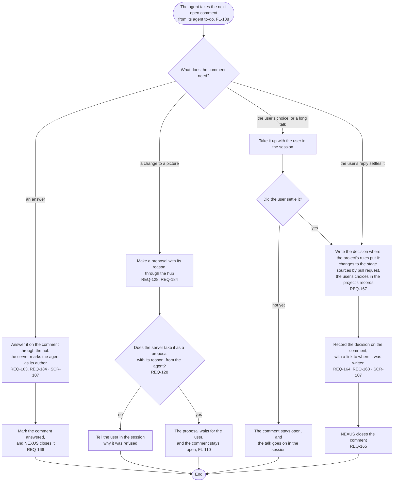

# FL-109 Answer a comment

[한국어](FL-109-answer-a-comment.ko.md)

Serves: REQ-128, REQ-163, REQ-164, REQ-165, REQ-166, REQ-167, REQ-168, REQ-184

Context: CTX-014 Discussion. Starts when the agent takes an open comment from its agent to-do (FL-108); the user can also bring a comment up in the session. New in NEXUS 0.2.

The agent's own comments, such as one that raises a question on a discrepancy, go through the hub the same way and carry the agent as their author. Replies on a comment, and whether the user can open again a comment that the agent marked answered, are point 9 of the [README](README.md#points-for-the-functional-spec).
