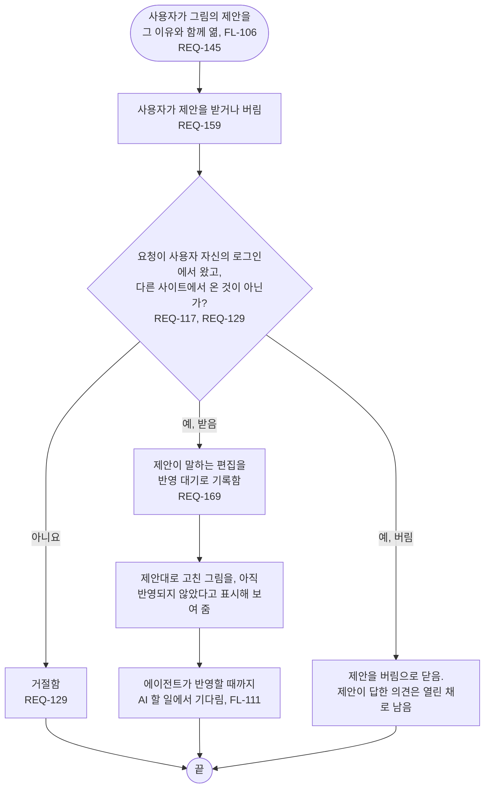

# FL-110 제안 받거나 버리기

[English](FL-110-accept-or-dismiss-a-proposal.md)

다루는 요구사항: REQ-117, REQ-129, REQ-145, REQ-159, REQ-169

맥락: CTX-014 논의, 그리고 받은 제안은 CTX-010 편집. 사용자가 휴대폰이나 PC의 그림 보기(FL-106)에서 제안을 열 때 시작합니다. NEXUS 0.2에서 새로 더합니다.

그림의 내용은 단계별 원본에서만 오는데, 받은 제안을 그림에 어떻게 보여 줄지, 그리고 버렸다는 것을 에이전트가 어떻게 알지는 [README](README.ko.md#기능-명세에서-정할-것)의 10번입니다.
