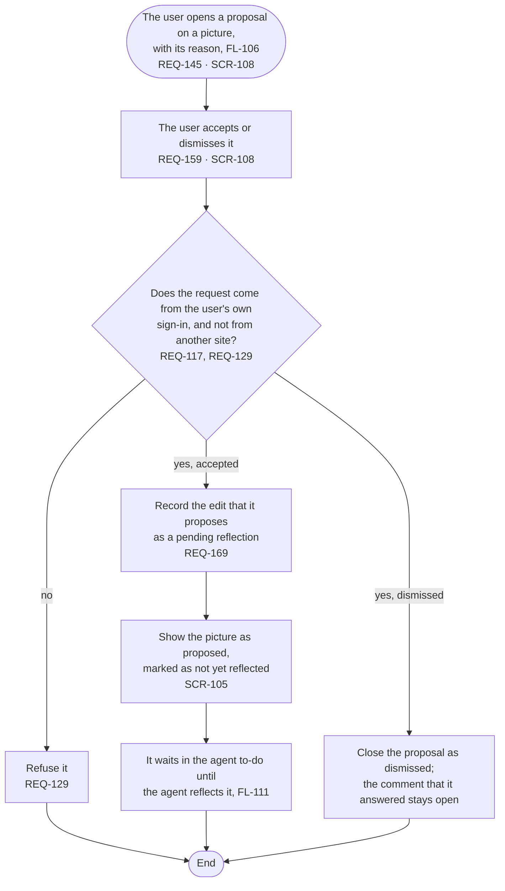

# FL-110 Accept or dismiss a proposal

[한국어](FL-110-accept-or-dismiss-a-proposal.ko.md)

Serves: REQ-117, REQ-129, REQ-145, REQ-159, REQ-169

Context: CTX-014 Discussion, and CTX-010 Editing for an accepted proposal. Starts when the user opens a proposal in the picture view (FL-106), on a phone or a PC. New in NEXUS 0.2.

How an accepted proposal shows on a picture whose content comes only from the stage sources, and what a dismissal tells the agent, are point 10 of the [README](README.md#points-for-the-functional-spec).
