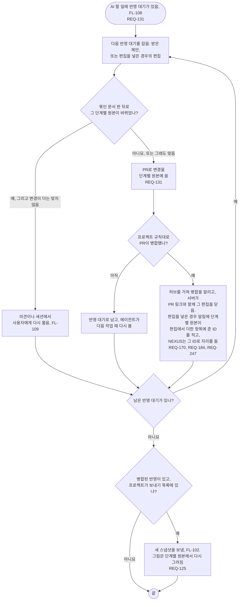

# FL-111 PR로 반영하기

[English](FL-111-reflect-by-pull-request.md)

다루는 요구사항: REQ-125, REQ-131, REQ-170, REQ-184, REQ-247

맥락: CTX-010 편집. 에이전트가 프로젝트에서 일을 시작할 때 AI 할 일(FL-108)에 반영 대기가 있으면 시작합니다. 반영 대기는 받은 제안, 그리고 편집을 넣은 경우 사용자의 편집입니다. NEXUS 0.2에서 새로 더합니다.

NEXUS는 Git에 쓰지 않습니다. 팀 프로젝트에서도 에이전트가 모든 반영을 PR로 씁니다. 편집을 넣은 경우, 그사이 그림이 다시 그려진 보낸 편집은 앞선 문서 판에서 보낸 것으로 표시되어 여기서 기다리고(FL-125), 편집 충돌은 임시 저장만 됩니다(FL-115, 01단계 핫스팟 22). 단계별 원본이 앞서 나간 반영과, 병합되지 않고 닫힌 PR은 [README](README.ko.md#기능-명세에서-정할-것)의 11번입니다.
