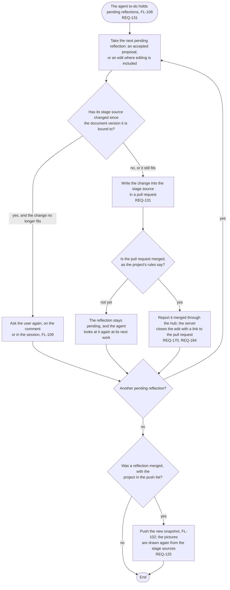

# FL-111 Reflect by pull request

[한국어](FL-111-reflect-by-pull-request.ko.md)

Serves: REQ-125, REQ-131, REQ-170, REQ-184

Context: CTX-010 Editing. Starts when the agent's work on a project starts with pending reflections in its agent to-do (FL-108): accepted proposals, and the user's edits where editing is included. New in NEXUS 0.2.

NEXUS never writes to Git: the agent writes every reflection by pull request, in team projects too. A reflection whose stage source moved on, and a pull request closed without being merged, are point 11 of the [README](README.md#points-for-the-functional-spec).
