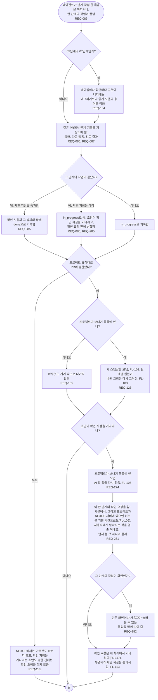

# FL-112 단계 작업 한 묶음 마치기

[English](FL-112-finish-stage-work.md)

다루는 요구사항: REQ-085, REQ-086, REQ-087, REQ-105, REQ-125, REQ-154, REQ-274, REQ-281, REQ-282, REQ-285

맥락: CTX-007 단계 진행, 그리고 CTX-013 점검이 짝짓는 데 쓰는 용어. 에이전트가 프로젝트에서 초안이나 단계별 원본의 변경 같은 단계 작업 한 묶음을 마치거나, 한 단계의 작업이 끝날 때 시작합니다. NEXUS 0.2에서 새로 더합니다. 1차에서는 에이전트가 대신 기기의 진행 기록 파일에 진행을 기록했습니다. 2026-11-11의 설계 수정이 확인 지점을 기다리는 초안의 병합부터 확인 요청까지의 단계를 더했습니다(REQ-274, REQ-281, REQ-282, REQ-285).

기록은 작업과 같은 PR에 들어가므로, 기록과 그것이 말하는 원본이 함께 병합됩니다. 기록을 저장소의 어디에 둘지, 그리고 여러 부분으로 된 프로젝트가 부분마다 기록을 둘지는 [README](README.ko.md#기능-명세에서-정할-것)의 4번입니다. 확인 지점을 기다리는 초안은 단계 기록을 진행 중으로 둔 채 먼저 병합해, 사용자가 통과시켜 달라고 부탁받는 것을 NEXUS가 그리게 합니다(REQ-285. README에 있는 2026-11-02의 첫 선택을 규칙으로 만든 것이며 02단계의 D18이 열려 있음). 병합된 파일이 곧 끝난 단계는 아니며, 단계는 확인 지점을 통과하고 기록한 때에만 끝납니다(FL-113). 확인 요청은 한 단계에 대한 것이고 휴대폰에서 통째로 읽을 만큼 짧으며(REQ-281), 첫 화면의 통과가 거기에 기댑니다(FL-117). 확인 요청에 무엇이 담기는지는 29번입니다.
