# FL-112 Finish a unit of stage work

[한국어](FL-112-finish-stage-work.ko.md)

Serves: REQ-085, REQ-086, REQ-087, REQ-105, REQ-125, REQ-154, REQ-274, REQ-281, REQ-282, REQ-285

Context: CTX-007 Stage progress, with the terms that CTX-013 Cross-checking pairs by. Starts when the agent finishes a unit of stage work on a project, such as a draft or a change of a stage source, or a stage's work ends. New in NEXUS 0.2; in phase 1 the agent recorded progress in the device's status file instead. The design revision of 2026-11-11 added the steps from the merge of a draft that waits for its checkpoint to the checkpoint request (REQ-274, REQ-281, REQ-282, REQ-285).

```mermaid
flowchart TD
  A(["The agent finishes a unit of stage work,<br/>or a stage's work ends<br/>REQ-086"]) --> B{"Is it stage 05 or stage 07?"}
  B -->|yes| B1["Name, for each table or screen, the glossary<br/>terms of the aggregates or read models<br/>that it stands for<br/>REQ-154"]
  B -->|no| C
  B1 --> C["Write the stage's record into the repository in<br/>the same pull request: its state, its next action<br/>and any review findings<br/>REQ-086, REQ-087"]
  C --> D{"Is the stage's work done?"}
  D -->|yes, and its checkpoint is passed| D1["Record done, with the checkpoint<br/>and its date<br/>REQ-085"]
  D -->|yes, but its checkpoint is not passed| D2["Keep it in_progress: the draft waits for its checkpoint,<br/>and is merged before the checkpoint request<br/>REQ-085, REQ-285"]
  D -->|no| D3["Record in_progress"]
  D1 --> E{"Is the pull request merged,<br/>as the project's rules say?"}
  D2 --> E
  D3 --> E
  E -->|not yet| E1["Nothing changes in NEXUS, and a draft that waits for<br/>its checkpoint is not requested before it is merged<br/>REQ-285"]
  E1 --> Z(["End"])
  E -->|yes| F{"Is the project in the push list?"}
  F -->|no| F1["Nothing leaves the device<br/>REQ-105"]
  F -->|yes| G["Push the new snapshot, FL-102; the pictures<br/>whose stage sources changed are drawn again, FL-103<br/>REQ-125"]
  F1 --> H{"Does the draft wait for its checkpoint?"}
  G --> H
  H -->|no| Z
  H -->|yes| I["Where the project is in the push list, read<br/>the agent to-do again, FL-108<br/>REQ-274"]
  I --> J["Make the checkpoint request for this one stage, in the session<br/>and, where the project is on the NEXUS server, as a comment<br/>through the hub, FL-109: at most ten lines on what changes<br/>for the user, and one thing to look at first<br/>REQ-281"]
  J --> K{"Is the stage's work screens?"}
  K -->|yes| K1["Show with it the built screen or<br/>a mockup that the user can press<br/>REQ-282"]
  K -->|no| L
  K1 --> L["The request waits in my turn, FL-117, and<br/>the user passes the checkpoint, FL-113"]
  L --> Z
```

The record goes in the same pull request as the work, so that the record and the sources that it describes are merged together. Where the records live in the repository, and whether a project with several parts keeps one for each part, are point 4 of the [README](README.md#points-for-the-functional-spec). A draft that waits for its checkpoint is merged first, with its record as in progress, so that NEXUS draws what the user is asked to pass (REQ-285, which makes a rule of the first choice of 2026-11-02 in the README and is open under D18 of stage 02); a merged file is still not a finished stage, and the stage is done only when its checkpoint is passed and recorded (FL-113). The checkpoint request is for one stage and short enough to be read whole on a phone (REQ-281), which the pass on the first page depends on (FL-117); what it holds is point 29.
