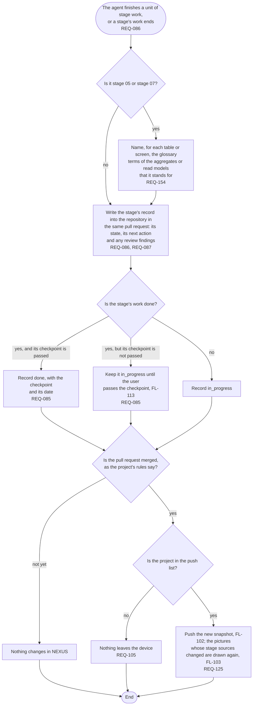

# FL-112 Finish a unit of stage work

[한국어](FL-112-finish-stage-work.ko.md)

Serves: REQ-085, REQ-086, REQ-087, REQ-105, REQ-125, REQ-154

Context: CTX-007 Stage progress, with the terms that CTX-013 Cross-checking pairs by. Starts when the agent finishes a unit of stage work on a project, such as a draft or a change of a stage source, or a stage's work ends. New in NEXUS 0.2; in phase 1 the agent recorded progress in the device's status file instead.

The record goes in the same pull request as the work, so that the record and the sources that it describes are merged together. Where the records live in the repository, and whether a project with several parts keeps one for each part, are point 4 of the [README](README.md#points-for-the-functional-spec).
