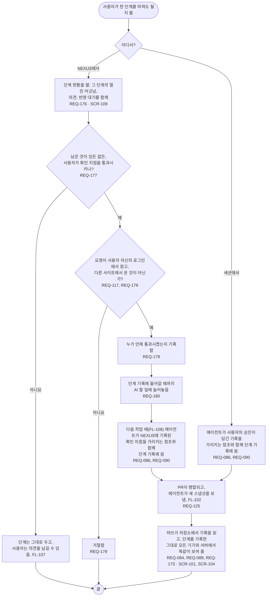

# FL-113 단계의 확인 지점 통과시키기

[English](FL-113-pass-a-checkpoint.md)

다루는 요구사항: REQ-084, REQ-086, REQ-089, REQ-090, REQ-117, REQ-125, REQ-173, REQ-176, REQ-177, REQ-178, REQ-179, REQ-180

맥락: CTX-007 단계 진행. 사용자가 NEXUS의 단계 현황에서나 에이전트와의 세션에서, 한 단계를 마쳐도 될지 볼 때 시작합니다. NEXUS 0.2에서 새로 더합니다.

확인 지점은 사용자만 통과시킵니다. AI의 추천, 읽음 표시, 편집 시각은 확인 지점이 아닙니다. NEXUS에서 통과시킨 확인 지점을 에이전트가 기록하기 전까지 단계 현황이 그것을 어떻게 보여 줄지는 [README](README.ko.md#기능-명세에서-정할-것)의 15번입니다.
