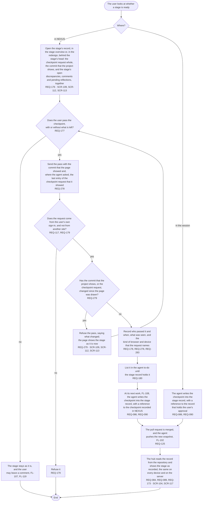

# FL-113 Pass a stage's checkpoint

[한국어](FL-113-pass-a-checkpoint.ko.md)

Serves: REQ-084, REQ-086, REQ-089, REQ-090, REQ-117, REQ-125, REQ-173, REQ-176, REQ-177, REQ-178, REQ-179, REQ-180, REQ-278, REQ-279, REQ-283

Context: CTX-007 Stage progress. Starts when the user looks at whether a stage is ready, in the stage overview of NEXUS or in the session with the agent. New in NEXUS 0.2; the design revision of 2026-11-11 binds a pass to what the user saw (REQ-278, REQ-279, under D17 of stage 02, decided on 2026-11-12) and names the stage's record of the redesign beside the stage overview.

Only the user passes a checkpoint; an AI recommendation, a read receipt or an edit time is not one. A pass binds what the user saw, the commit that the project shows and the last entry of the checkpoint request, so that a push or a reply that arrives while the page is open does not pass unseen (REQ-278, REQ-279; point 28 of the README). The kind of browser and device is recorded so that a pass from a browser that an agent drives can be told afterwards (REQ-283); on a project that is not synthetic a browser agent leaves the pass to the user (REQ-284, a rule of the stage 12 skill, which no flow draws). Where editing is included, a workshop's checkpoint after Step 1-b, 7 or 9 is passed here too, in NEXUS only, and the server records the board version that the user passed (FL-116, REQ-261, D15 of stage 02). How the stage overview shows a checkpoint passed in NEXUS before the agent records it is point 15 of the [README](README.md#points-for-the-functional-spec).
