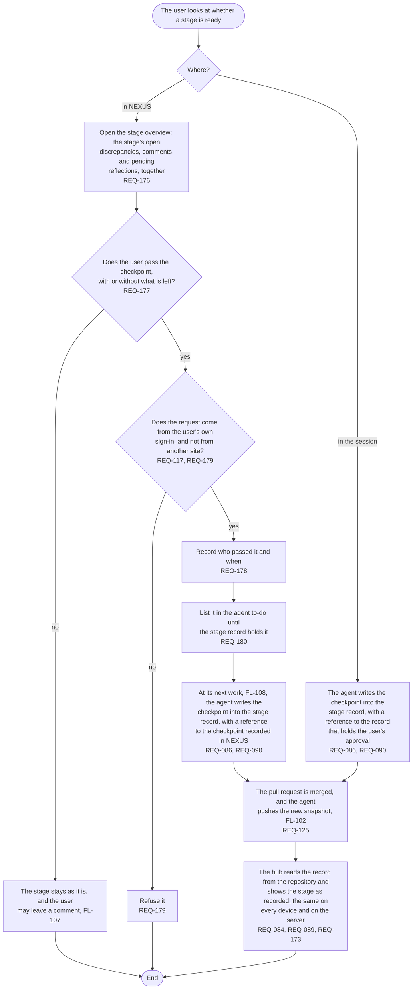

# FL-113 Pass a stage's checkpoint

[한국어](FL-113-pass-a-checkpoint.ko.md)

Serves: REQ-084, REQ-086, REQ-089, REQ-090, REQ-117, REQ-125, REQ-173, REQ-176, REQ-177, REQ-178, REQ-179, REQ-180

Context: CTX-007 Stage progress. Starts when the user looks at whether a stage is ready, in the stage overview of NEXUS or in the session with the agent. New in NEXUS 0.2.

Only the user passes a checkpoint; an AI recommendation, a read receipt or an edit time is not one. How the stage overview shows a checkpoint passed in NEXUS before the agent records it is point 15 of the [README](README.md#points-for-the-functional-spec).
