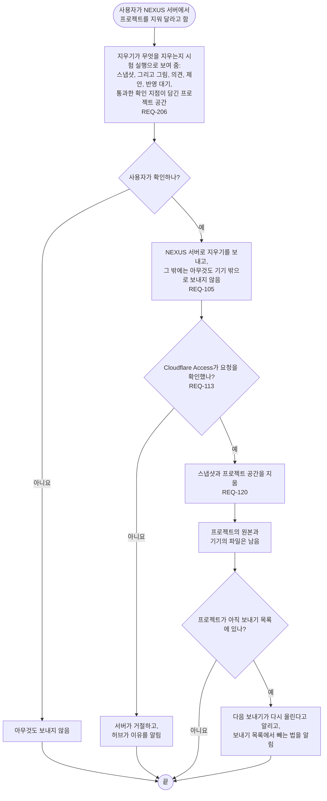

# FL-114 NEXUS 서버에서 프로젝트 지우기

[English](FL-114-remove-a-project.md)

다루는 요구사항: REQ-105, REQ-113, REQ-120, REQ-206

맥락: CTX-009 함께 보기. 사용자가 NEXUS 서버에서 프로젝트를 지워 달라고 할 때 시작합니다. 스냅샷 지우기는 1차에서 만들었고, NEXUS 0.2는 프로젝트 공간도 함께 지웁니다(REQ-120).

의견에 대한 결정은 에이전트가 쓴 곳, 곧 Git과 프로젝트 기록에 남습니다. 열린 의견과 반영 대기는 공간과 함께 지워지므로, [README](README.ko.md#기능-명세에서-정할-것)의 17번대로 사용자가 확인하기 전에 그것을 늘어놓습니다.
