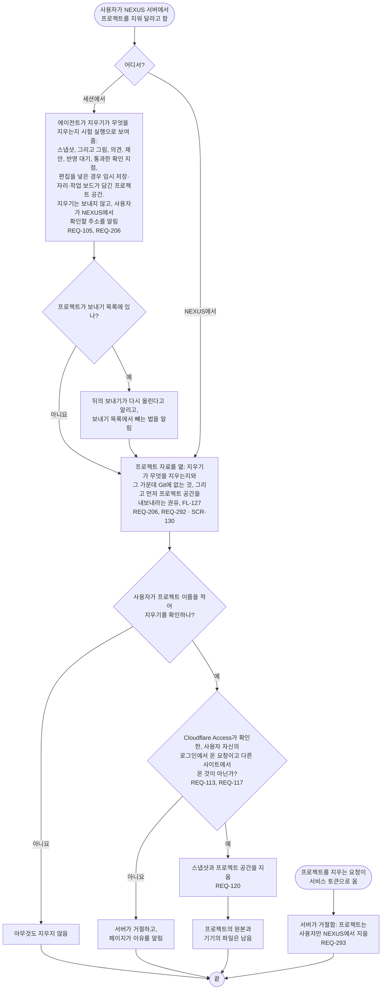

# FL-114 NEXUS 서버에서 프로젝트 지우기

[English](FL-114-remove-a-project.md)

다루는 요구사항: REQ-105, REQ-113, REQ-117, REQ-120, REQ-206, REQ-292, REQ-293

맥락: CTX-009 함께 보기. 사용자가 에이전트와의 세션에서나 NEXUS에서, NEXUS 서버의 프로젝트를 지워 달라고 할 때 시작합니다. 스냅샷 지우기는 1차에서 만들었고, NEXUS 0.2는 프로젝트 공간도 함께 지웁니다(REQ-120). 2026-11-11의 설계 수정부터는 사용자가 자기 로그인으로 NEXUS에서 확인하고, 서버는 서비스 토큰으로 온 지우기를 거절합니다(REQ-293): 공간에는 Git에 없는 의견, 제안, 통과한 확인 지점이 있는데, 그때까지는 모든 세션이 가진 토큰으로 그것을 지울 수 있었습니다.

의견에 대한 결정은 에이전트가 쓴 곳, 곧 Git과 프로젝트 기록에 남습니다. 열린 의견과 반영 대기는 공간과 함께 지워지므로, [README](README.ko.md#기능-명세에서-정할-것)의 17번대로 사용자가 확인하기 전에 그것을 늘어놓고, 내보내기가 Git에 없는 것의 사본을 남깁니다(FL-127). 지운 뒤에는 서버가 그 프로젝트를 더는 갖고 있지 않으므로 보내기 작업은 아무것도 보내지 않고(FL-102), 보내기 목록에 그 프로젝트가 남아 있는 기기는 다음 보내기 때 빈 공간과 함께 그것을 다시 올립니다. 사용자가 페이지에서 어떻게 확인하는지, 서버가 서비스 토큰을 거절한 뒤 허브의 지우기 명령이 무엇을 하는지는 30번입니다.
