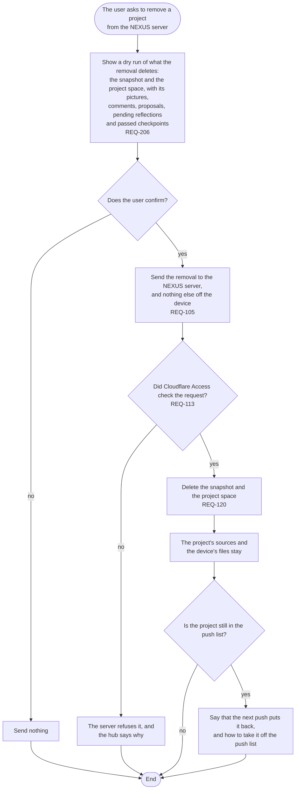

# FL-114 Remove a project from the NEXUS server

[한국어](FL-114-remove-a-project.ko.md)

Serves: REQ-105, REQ-113, REQ-120, REQ-206

Context: CTX-009 Sharing. Starts when the user asks to remove a project from the NEXUS server. Built in phase 1 for snapshots; NEXUS 0.2 deletes the project space as well (REQ-120).

The decisions on its comments stay where the agent wrote them, in Git and in the project's records; open comments and pending reflections go with the space. Point 17 of the [README](README.md#points-for-the-functional-spec) lists them before the user confirms.
