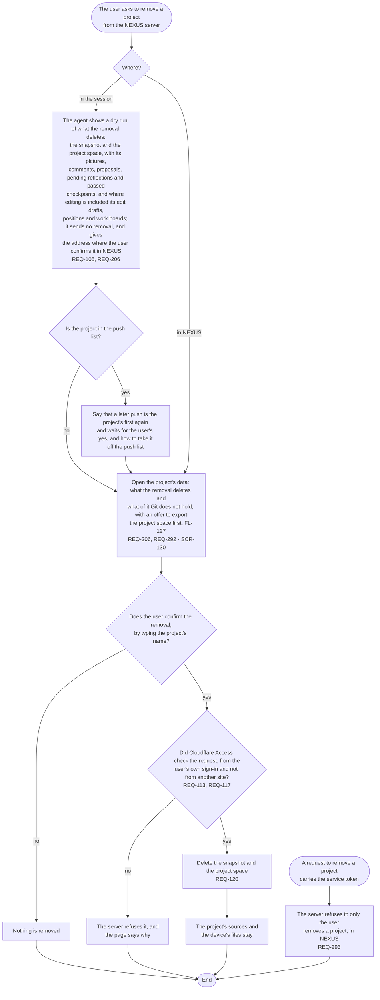

# FL-114 Remove a project from the NEXUS server

[한국어](FL-114-remove-a-project.ko.md)

Serves: REQ-105, REQ-113, REQ-117, REQ-120, REQ-206, REQ-292, REQ-293

Context: CTX-009 Sharing. Starts when the user asks to remove a project from the NEXUS server, in the session with the agent or in NEXUS. Built in phase 1 for snapshots; NEXUS 0.2 deletes the project space as well (REQ-120). Since the design revision of 2026-11-11 the user confirms in NEXUS, under the user's own sign-in, and the server refuses a removal that carries the service token (REQ-293): a space holds comments, proposals and passed checkpoints that Git does not, and until then the token that every session holds could delete them.

The decisions on its comments stay where the agent wrote them, in Git and in the project's records; open comments and pending reflections go with the space. Point 17 of the [README](README.md#points-for-the-functional-spec) lists them before the user confirms, and the export keeps a copy of what Git does not hold (FL-127). After a removal the push job sends nothing for the project, since the server no longer holds it (FL-102), and a push from a device whose push list still names the project is the project's first again: it waits for the user's yes and then puts the project back with an empty space. How the user confirms on the page, and what the hub's removal command does once the server refuses the service token, are point 30.
