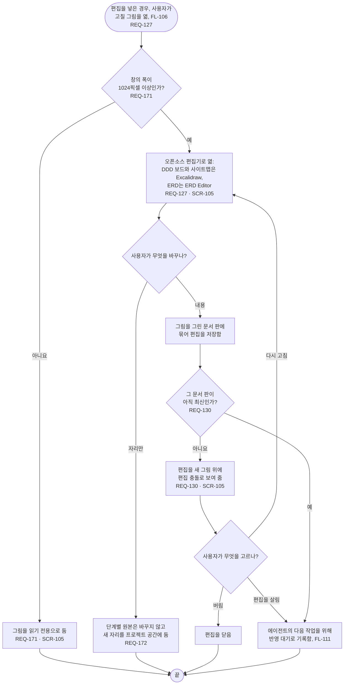

# FL-115 PC에서 그림 고치기

[English](FL-115-edit-a-picture.md)

다루는 요구사항: REQ-127, REQ-130, REQ-171, REQ-172

맥락: CTX-010 편집. 편집을 넣은 경우, 곧 ② 차례이며 NEXUS 0.2에는 없습니다. 사용자가 그림 보기(FL-106)에서 고칠 그림을 열 때 시작합니다.

② 차례는 ① 차례가 읽기 전용으로 쓰는 편집기에서 편집을 켭니다(02단계의 D11). 이 흐름을 지금 그려 두는 것은 NEXUS 0.2의 자료, 곧 자리와 문서 판이 그것을 담을 여지를 남기게 하려는 것입니다.
