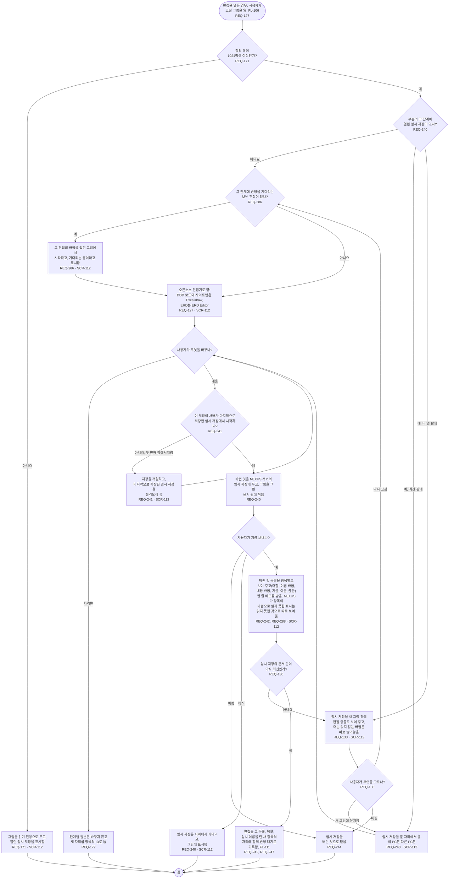

# FL-115 PC에서 그림 고치기

[English](FL-115-edit-a-picture.md)

다루는 요구사항: REQ-127, REQ-130, REQ-171, REQ-172, REQ-240, REQ-241, REQ-242, REQ-244, REQ-247, REQ-286, REQ-288

맥락: CTX-010 편집, 그리고 CTX-012 그림의 자리. 편집을 넣은 경우, 곧 ② 차례이며 NEXUS 0.2에는 없습니다. 사용자가 그림 보기(FL-106)에서 고칠 그림을 열 때 시작합니다. 2026-11-07에 ② 차례의 01단계 프레임에서 다시 그렸습니다. 2026-11-11의 설계 수정이 기다리는 편집 위에서 시작하기(REQ-286)와 읽지 못한 표시(REQ-288)를 더했습니다.

편집은 02단계의 D11이 고른 편집기인 Excalidraw와 ERD Editor를 씁니다. NEXUS 0.2는 그 편집기로 편집을 되읽을 수 있게 그리지 않으므로, 편집은 REQ-287(FL-103)과 열려 있는 02단계 D20의 첫째 시제품에서 시작하고, ②a 부분의 범위 확인 지점이 D11의 편집기 선택을 그대로 두거나 바꿉니다(2026-11-11의 D11 바로잡기). 기다리는 편집 위에서 시작한 임시 저장(REQ-286)은 그 편집을 자기가 시작한 곳의 일부로 적어 두어, 그 편집이 보낸 대로 반영되면 다시 그린 그림을 편집 충돌이 아니라 유지로 만납니다. 그 방법과, 읽지 못한 표시(REQ-288)를 보낼 때 어떻게 할지는 [README](README.ko.md#기능-명세에서-정할-것)의 31번입니다. 새 그림에 임시 저장을 유지하기는 바뀐 것이 모두 아직 맞을 때만 고를 수 있고, 아니면 다시 고치거나 버립니다. 보낸 편집은 편집 충돌이 되지 않습니다: 반영 대기로 남아, 에이전트가 새 문서에 맞으면 넣고 안 맞으면 사용자에게 다시 묻습니다(FL-111, 01단계 핫스팟 22). 기다리는 동안에도 사용자는 그것을 버릴 수 있습니다(FL-125). 편집에서 더한 항목의 자리는 이 단계의 ② 차례 확인 지점이 2026-11-07에 추천대로 정한 02단계의 D14를 따릅니다.
