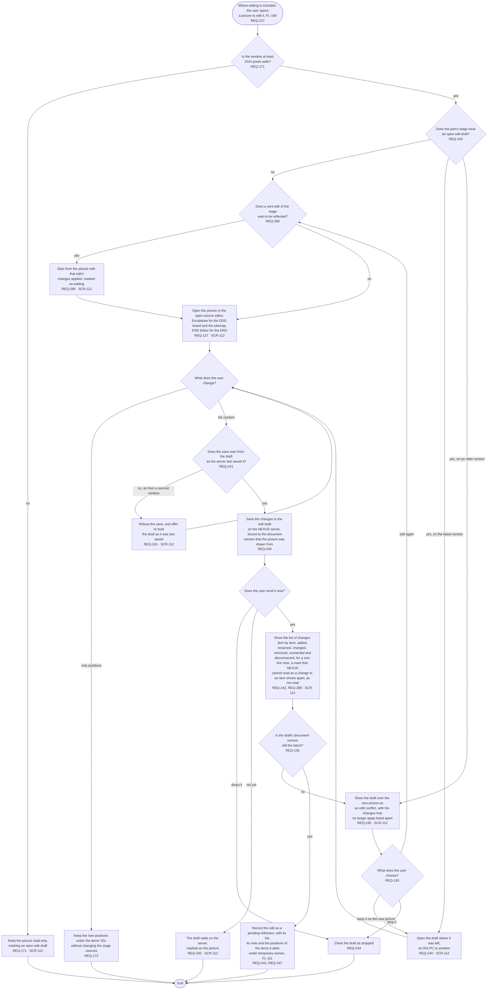

# FL-115 Edit a picture on a PC

[한국어](FL-115-edit-a-picture.ko.md)

Serves: REQ-127, REQ-130, REQ-171, REQ-172, REQ-240, REQ-241, REQ-242, REQ-244, REQ-247, REQ-286, REQ-288

Context: CTX-010 Editing, with Positions of CTX-012 Pictures. Where editing is included, in phase ②; not in NEXUS 0.2. Starts when the user opens a picture to edit it in the picture view (FL-106). Redrawn on 2026-11-07 from stage 01's frames for phase ②. The design revision of 2026-11-11 added the start on a waiting edit (REQ-286) and the marks that are not read (REQ-288).

Editing uses the editors that D11 of stage 02 chose, Excalidraw and ERD Editor. NEXUS 0.2 does not draw with them in a way that an edit can be read back from, so editing starts with REQ-287 (FL-103) and with the first prototype of D20 of stage 02, which is open, and the scope checkpoint of part ②a confirms or changes D11's choice of editors (the correction to D11 of 2026-11-11). A draft that starts on a waiting edit (REQ-286) names that edit as part of what it started from, so that it meets the redrawn picture as kept, not as an edit conflict, once the edit is reflected as sent; how, and what sending does with a mark that is not read (REQ-288), are point 31 of the [README](README.md#points-for-the-functional-spec). Keeping the draft on the new picture is offered only when every change still applies; otherwise the user edits again or drops it. A sent edit is never an edit conflict: it waits to be reflected, and the agent puts it in if it fits the new document and asks the user again if it does not (FL-111, hotspot 22 of stage 01). The user can still drop it while it waits (FL-125). The positions of the items that an edit adds follow D14 of stage 02, which this stage's checkpoint for phase ② decided as recommended on 2026-11-07.
