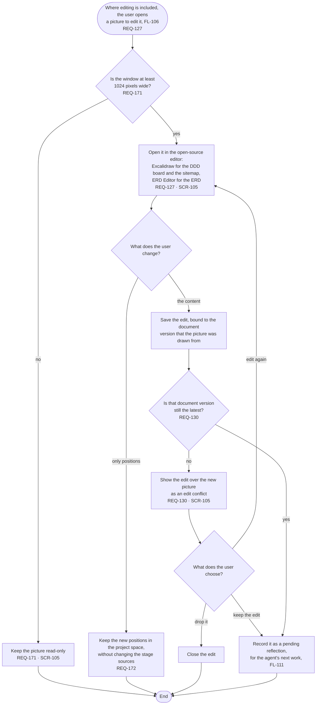

# FL-115 Edit a picture on a PC

[한국어](FL-115-edit-a-picture.ko.md)

Serves: REQ-127, REQ-130, REQ-171, REQ-172

Context: CTX-010 Editing. Where editing is included, in phase ②; not in NEXUS 0.2. Starts when the user opens a picture to edit it in the picture view (FL-106).

Phase ② turns on editing in the editors that phase ① uses read-only (D11 of stage 02). The flow is drawn now so that the data of NEXUS 0.2, such as positions and document versions, leaves room for it.
