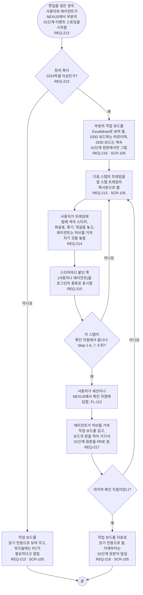

# FL-116 작업 보드에서 워크숍 하기

[English](FL-116-hold-a-workshop.md)

다루는 요구사항: REQ-213, REQ-214, REQ-215, REQ-216, REQ-217, REQ-218

맥락: CTX-010 편집. ② 차례가 작업 보드 자신의 스텝을 그릴 때까지 여기에 둡니다(01단계 핫스팟 14). 편집을 넣은 경우, 곧 ② 차례이며 NEXUS 0.2에는 없습니다. 사용자와 에이전트가 PC에서 부분의 01단계 이벤트 스토밍을 NEXUS에서 시작할 때 시작합니다. 2026-11-03 관리자의 선택으로 그렸습니다.

에이전트는 사용자와 함께 세션에서 일하고, NEXUS의 다른 곳에서처럼 허브를 거쳐서만 작업 보드에 닿습니다. NEXUS는 에이전트를 부르지 않으므로, 에이전트는 사용자가 놓은 것을 사용자가 세션에서 알려 줄 때나 다음 작업 때 읽습니다(FL-108). 확인 지점의 PR이 병합되어 보내지면 FL-103이 01단계 원본에서 DDD 보드를 다시 그리므로, DDD 보드는 확인 지점마다 작업 보드를 따라잡습니다.

이 흐름은 FL-115처럼 NEXUS 0.2의 자료가 그것을 담을 여지를 남기도록 지금 그려 둡니다. ② 차례는 01단계의 기존 제품에 더하기 규칙대로 작업 보드 자신의 스텝을 새 프레임에 그리고, 작업 보드가 따로 된 컨텍스트인지도 거기서 정합니다(01단계 핫스팟 14). 팀원이 작업 보드에서 함께 실시간으로 하는 일은 팀원과 함께 오고, 그때까지 팀 워크숍은 Miro에서 합니다.
