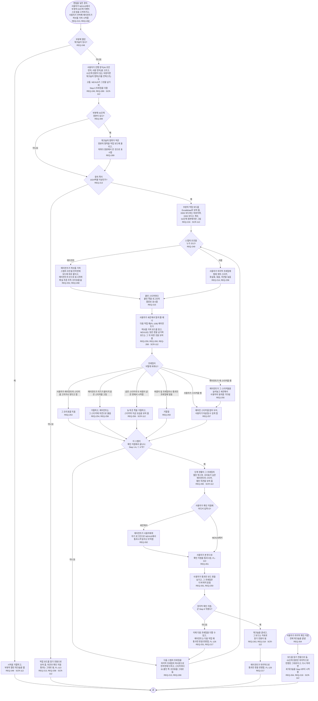

# FL-116 작업 보드에서 워크숍 하기

[English](FL-116-hold-a-workshop.md)

다루는 요구사항: REQ-213, REQ-214, REQ-215, REQ-216, REQ-217, REQ-218, REQ-248, REQ-249, REQ-250, REQ-251, REQ-252, REQ-253, REQ-254, REQ-255, REQ-256, REQ-257, REQ-258, REQ-259, REQ-260, REQ-261, REQ-262, REQ-263, REQ-264, REQ-266, REQ-268, REQ-269, REQ-289

맥락: CTX-016 워크숍, 그리고 의견은 CTX-014 논의, 확인 지점은 CTX-007 단계 진행. 편집을 넣은 경우, 곧 ② 차례이며 NEXUS 0.2에는 없습니다. 사용자가 PC에서 NEXUS로 부분의 01단계 이벤트 스토밍을 시작하거나, 세션에서 에이전트에게 시작해 달라고 할 때 시작합니다. 2026-11-03 관리자의 선택으로 그렸고, 2026-11-07에 ② 차례의 01단계 프레임에서 다시 그렸습니다. 2026-11-11의 설계 수정이 워크숍이 시작하는 원본의 항목을 더했습니다(REQ-289).

에이전트는 사용자와 함께 세션에서 일하고, NEXUS의 다른 곳에서처럼 허브를 거쳐서만 작업 보드에 닿습니다. NEXUS는 에이전트를 부르지 않으므로, 에이전트는 사용자가 놓은 것을 사용자가 세션에서 알려 줄 때나 다음 작업 때 읽습니다(FL-108). 확인 지점의 PR이 병합되어 보내지면 FL-103이 01단계 원본에서 DDD 보드를 다시 그리므로, DDD 보드는 확인 지점마다 작업 보드를 따라잡습니다(FL-126). 01단계 원본이 이미 있는 부분은 워크숍의 범위 안 원본의 항목을 원본에서 온 것으로 표시해 보드에 올린 채 시작합니다. 그래야 보드와 문서가 같은 항목에서 시작하고, 에이전트가 나중에 사용자가 보드에서 뗀 항목과 보드에 올린 적 없는 항목을 가릴 수 있습니다(REQ-289, REQ-290, FL-126). 어느 프레임에 올리고 그 표시가 무엇을 보여 주는지는 [README](README.ko.md#기능-명세에서-정할-것)의 32번입니다.

확인 지점을 통과한 프레임은 통과한 그대로 남고 다음 스텝의 프레임은 통과 뒤에만 오므로, 통과 뒤 바뀐 것은 뒤 프레임에서 바뀌어 다음 확인 지점으로 갑니다. 의견은 보드의 바꿈이 아니어서, 열린 워크숍의 어느 프레임에도 남길 수 있습니다. 워크숍의 확인 지점은 이 단계의 ② 차례 확인 지점이 2026-11-07에 추천대로 정한 02단계의 D15를 따라 NEXUS에서만 통과시킵니다. 팀원이 작업 보드에서 함께 실시간으로 하는 일은 팀원과 함께 오고, 그때까지 팀 워크숍은 Miro에서 합니다.
