# FL-116 Hold a workshop on a work board

[한국어](FL-116-hold-a-workshop.ko.md)

Serves: REQ-213, REQ-214, REQ-215, REQ-216, REQ-217, REQ-218, REQ-248, REQ-249, REQ-250, REQ-251, REQ-252, REQ-253, REQ-254, REQ-255, REQ-256, REQ-257, REQ-258, REQ-259, REQ-260, REQ-261, REQ-262, REQ-263, REQ-264, REQ-266, REQ-268, REQ-269, REQ-289

Context: CTX-016 Workshops, with CTX-014 Discussion for comments and CTX-007 Stage progress for checkpoints. Where editing is included, in phase ②; not in NEXUS 0.2. Starts when the user starts a part's stage 01 event storming in NEXUS on a PC, or asks the agent in the session to start it. Drawn with the maintainer's choice of 2026-11-03 and redrawn on 2026-11-07 from stage 01's frames for phase ②. The design revision of 2026-11-11 added the source's items that a workshop starts from (REQ-289).

```mermaid
flowchart TD
  A(["Where editing is included, the user starts a part's<br/>stage 01 event storming in NEXUS, or the agent<br/>starts it through the hub when the user asks<br/>REQ-213, REQ-268"]) --> B{"Does the part have<br/>an open workshop?<br/>REQ-248"}
  B -->|yes| B1["Refuse the start, and open<br/>the part's open workshop<br/>REQ-248 · SCR-112"]
  B1 --> Z(["End"])
  B -->|no| C["The user chooses the way of working, the agent's<br/>draft first or people first, and for a part with a stage 01<br/>source the workshop's scope, the contexts that it works on;<br/>NEXUS records them and adds the Step 0 frame<br/>REQ-249, REQ-289 · SCR-112"]
  C --> C2{"Does the part have<br/>a stage 01 source?<br/>REQ-289"}
  C2 -->|no| W
  C2 -->|yes| C3["Put on the work board the source's items that<br/>the workshop's scope names, each marked<br/>as from the source<br/>REQ-289"]
  C3 --> W{"Is the window at least<br/>1024 pixels wide?<br/>REQ-213"}
  W -->|no| W1["Show the work board read-only; comments<br/>and checkpoint passes still work, FL-113<br/>REQ-213, REQ-258 · SCR-112"]
  W1 --> Z
  W -->|yes| D["Show the part's work board in Excalidraw, apart<br/>from the DDD board, which is still drawn<br/>only from the stage 01 source<br/>REQ-216 · SCR-112"]
  D --> E{"Who drafts the step?<br/>REQ-249"}
  E -->|the agent| E1["The agent places the step's draft through the hub,<br/>all or nothing, at once on the board, marked as<br/>the agent's and labelled sure, inferred or guessed<br/>REQ-252, REQ-268"]
  E -->|people| E2["The user places stickies in the legend's colours,<br/>arrows, groups and comments on the last frame<br/>REQ-214, REQ-258"]
  E1 --> F
  E2 --> F["Mark each placed sticky with its author,<br/>from the kind of sign-in<br/>REQ-215"]
  F --> R["The agent reads the board through the hub when the<br/>user tells it in the session or at its next work, FL-108;<br/>NEXUS records the version read, and the board<br/>shows what changed since<br/>REQ-259, REQ-260, REQ-268 · SCR-112"]
  R --> G{"How does the frame change?"}
  G -->|the user corrects or confirms an agent's sticky| G1["Take its label off<br/>REQ-253"]
  G -->|the agent changes a sticky that it did not place| G2["Refuse it; the agent asks<br/>in a comment on the sticky<br/>REQ-254, REQ-258"]
  G -->|the agent removes stickies of its own| G3["The agent lists them and waits for<br/>the user's agreement in the session<br/>REQ-255"]
  G -->|the user removes a sticky| G6
  G -->|two changes start from the same version of a sticky| G4["Refuse the later one, and show<br/>the sticky as it is now<br/>REQ-256 · SCR-112"]
  G -->|a change reaches an earlier or a passed frame| G5["Refuse it<br/>REQ-250"]
  G3 --> G6["Keep the removed sticky folded away,<br/>for the user to restore<br/>REQ-257"]
  G1 --> H
  G2 --> H
  G4 --> H
  G5 --> H
  G6 --> H{"Does the step end at a checkpoint,<br/>after Step 1-b, 7 or 9?"}
  H -->|no| H1["Add the next step's frame, all or nothing,<br/>as a copy of the last one that keeps each<br/>sticky's ID, author and label<br/>REQ-213, REQ-269"]
  H1 --> E
  H -->|yes| J["The stage overview shows the frame's<br/>open hotspots, the agent's labelled<br/>stickies and the open comments<br/>REQ-266 · SCR-112"]
  J --> K{"Where does the user<br/>answer the checkpoint?"}
  K -->|in the session| K1["The agent asks the user to pass it<br/>in NEXUS, under the user's own sign-in<br/>REQ-262"]
  K1 --> K2
  K -->|in NEXUS| K2["The user passes the checkpoint<br/>at the version seen, FL-113<br/>REQ-261"]
  K2 --> L["Record the board version that the user<br/>passed; the frame no longer changes<br/>REQ-261, REQ-250"]
  L --> M{"Was it the last checkpoint,<br/>after Step 9?"}
  M -->|no| M1["The next frame may now be added; the agent<br/>reflects the version passed at its next work, FL-126<br/>REQ-251, REQ-217"]
  M1 --> H1
  M -->|yes| N["End the workshop; its board<br/>stays read-only, as material<br/>REQ-263, REQ-218 · SCR-112"]
  N --> N1["The agent reflects the last version<br/>passed, FL-126<br/>REQ-217"]
  N1 --> Z
  X(["The user ends the workshop<br/>before its last checkpoint<br/>REQ-264"]) --> X1["Keep the board read-only; the stage 01 source<br/>stays as last reflected, and a new workshop<br/>starts from Step 0<br/>REQ-264, REQ-218 · SCR-112"]
  X1 --> Z
```

The agent works in the session with the user and reaches the work board only through the hub, as everywhere in NEXUS. NEXUS never calls the agent, so the agent reads what the user placed when the user tells it in the session, or at its next work (FL-108). Once a checkpoint's pull request is merged and pushed, FL-103 draws the DDD board again from the stage 01 source, so the DDD board catches up with the work board at each checkpoint (FL-126). A part that already has a stage 01 source starts with the source's items in the workshop's scope on the board, marked as from the source, so that the board and the document start from the same items and the agent can later tell an item that the user took off the board from one that was never on it (REQ-289, REQ-290, FL-126); which frame holds them and what the mark shows are point 32 of the [README](README.md#points-for-the-functional-spec).

A frame that passed its checkpoint stays as it was passed, and the next step's frame comes only after the pass, so what changes after a pass is made in the later frames and goes to the next checkpoint. Comments are not changes to the board: they can be left on any frame of an open workshop. The user passes a workshop's checkpoint in NEXUS only, under D15 of stage 02, which this stage's checkpoint for phase ② decided as recommended on 2026-11-07. Team members' real-time work on a work board comes with team members; until then, team workshops stay on Miro.
