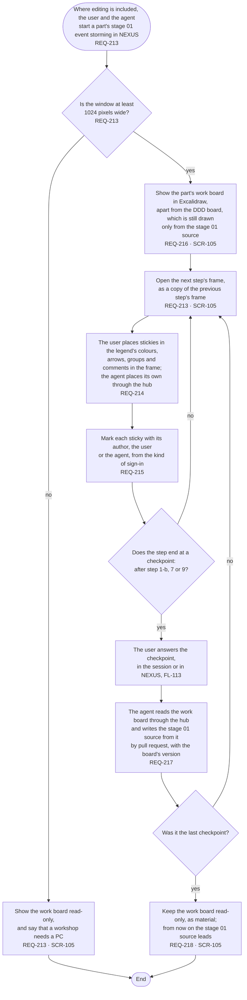

# FL-116 Hold a workshop on a work board

[한국어](FL-116-hold-a-workshop.ko.md)

Serves: REQ-213, REQ-214, REQ-215, REQ-216, REQ-217, REQ-218

Context: CTX-010 Editing, until phase ② draws the work board's own steps (hotspot 14 of stage 01). Where editing is included, in phase ②; not in NEXUS 0.2. Starts when the user and the agent start a part's stage 01 event storming in NEXUS, on a PC. Drawn with the maintainer's choice of 2026-11-03.

The agent works in the session with the user and reaches the work board only through the hub, as everywhere in NEXUS. NEXUS never calls the agent, so the agent reads what the user placed when the user tells it in the session, or at its next work (FL-108). Once a checkpoint's pull request is merged and pushed, FL-103 draws the DDD board again from the stage 01 source, so the DDD board catches up with the work board at each checkpoint.

The flow is drawn now so that the data of NEXUS 0.2 leaves room for it, as FL-115 is. Phase ② draws the work board's own steps in new frames, as stage 01's rule for adding to an existing product asks, and decides there whether the work board is a context of its own (hotspot 14 of stage 01). Team members' real-time work on a work board comes with team members; until then, team workshops stay on Miro.
