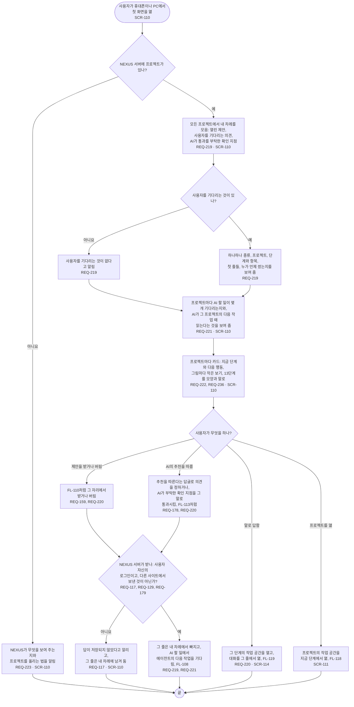

# FL-117 첫 화면에서 답하기

[English](FL-117-answer-from-the-first-page.md)

다루는 요구사항: REQ-117, REQ-129, REQ-159, REQ-178, REQ-179, REQ-219, REQ-220, REQ-221, REQ-222, REQ-223, REQ-236

맥락: CTX-014 논의. 사용자가 휴대폰이나 PC에서 NEXUS의 첫 화면을 열 때 시작합니다. 2026-11-06 다시 디자인에서 새로 더합니다. 그것을 만들기 전까지 사용자는 그림 보기에서 답하고(FL-107, FL-110), 확인 지점은 단계 현황에서 통과시킵니다(FL-113).

에이전트는 그 프로젝트의 일을 시작할 때에만 사용자의 답을 읽으므로, 페이지는 채팅처럼 보이지 않게 AI 할 일 옆에 그렇다고 적습니다(01단계의 핫스팟 6). 어떤 줄이 AI의 추천을 따르게 하고, 따르면 무엇을 쓰는지는 기능 명세에 있습니다(SPEC-143).
