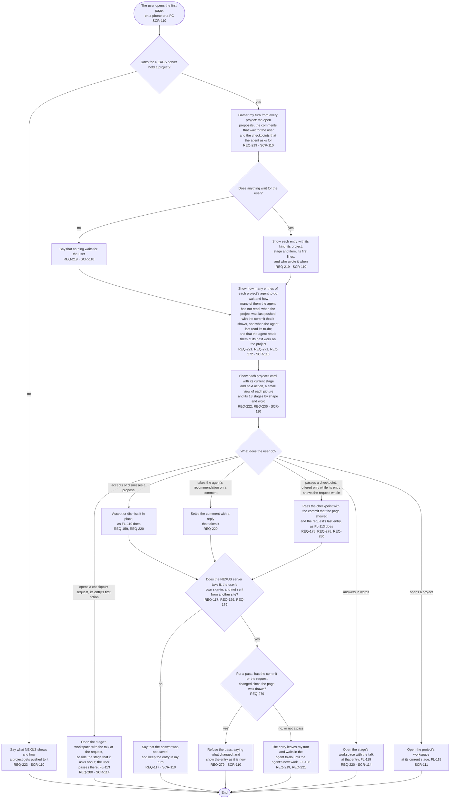

# FL-117 Answer from the first page

[한국어](FL-117-answer-from-the-first-page.ko.md)

Serves: REQ-117, REQ-129, REQ-159, REQ-178, REQ-179, REQ-219, REQ-220, REQ-221, REQ-222, REQ-223, REQ-236, REQ-271, REQ-272, REQ-278, REQ-279, REQ-280

Context: CTX-014 Discussion. Starts when the user opens NEXUS's first page, on a phone or a PC. New in the redesign of 2026-11-06; until it is built, the user answers in the picture view (FL-107, FL-110) and passes checkpoints in the stage overview (FL-113). The design revision of 2026-11-11 added the last push and the agent's last read, and changed how a checkpoint is passed from the page (REQ-278 to REQ-280, under D17 of stage 02, decided on 2026-11-12).

The agent reads what the user answers only when its work on the project starts, so the page says so beside the agent to-do instead of looking like a chat (hotspot 6 of stage 01). Beside it the page shows when each project was last pushed and when the agent last read its to-do, so that a loop that stands still shows (REQ-271, REQ-272). A checkpoint request offers opening it first, and the pass only while its entry shows the request whole (REQ-280): before the design revision of 2026-11-11 one press on the request's first lines passed the stage, with the words "as recommended". Which entries offer the agent's recommendation, and what taking one writes, is in the functional spec (SPEC-143); what the request whole is, and what the pass's button says, are point 29 of the [README](README.md#points-for-the-functional-spec).
