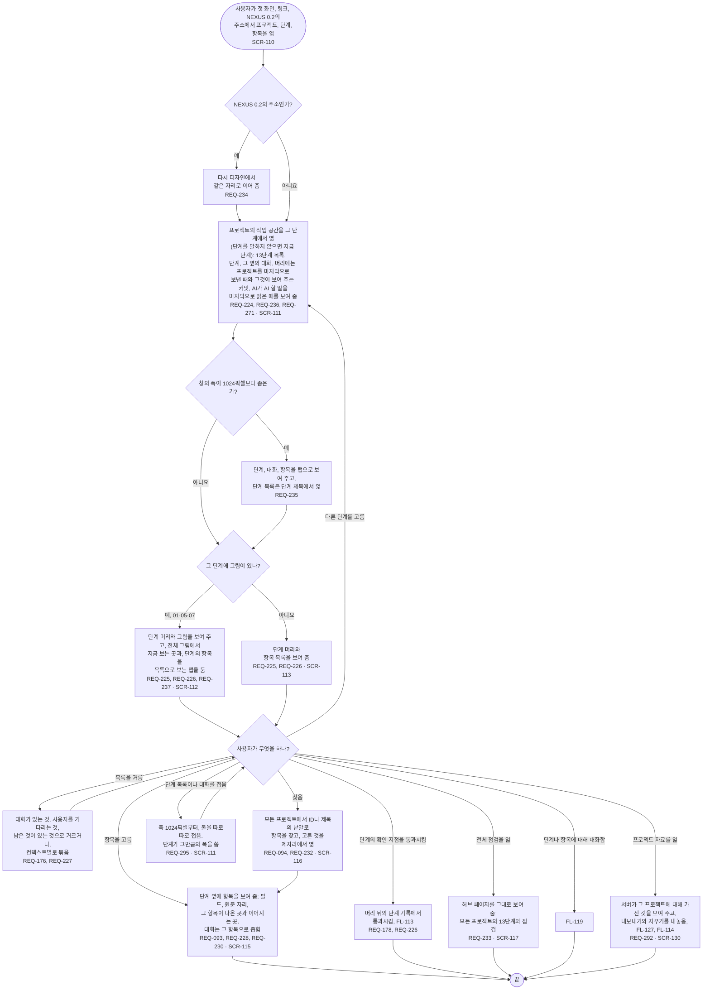

# FL-118 프로젝트 안에서 길 찾기

[English](FL-118-find-the-way-in-a-project.md)

다루는 요구사항: REQ-093, REQ-094, REQ-176, REQ-178, REQ-224, REQ-225, REQ-226, REQ-227, REQ-228, REQ-230, REQ-232, REQ-233, REQ-234, REQ-235, REQ-236, REQ-237, REQ-271, REQ-292, REQ-295

맥락: CTX-008 한눈에 보기. 사용자가 휴대폰이나 PC에서 첫 화면의 프로젝트, 링크의 단계나 항목, 또는 NEXUS 0.2의 주소를 열 때 시작합니다. 2026-11-06 다시 디자인에서 새로 더합니다. 그것을 만들기 전까지는 FL-105와 FL-106이 허브 페이지와 그림 보기를 거치는 길을 그립니다. 2026-11-11의 설계 수정이 마지막 보내기와 에이전트의 마지막 읽음을 보여 주는 작업 공간의 머리, 열 접기, 프로젝트 자료를 더했습니다.

찾기는 지금 허브 페이지에서 하는 일을 그대로 합니다(REQ-094). 첫 화면이 더는 허브 페이지가 아니라서, 모든 페이지 맨 위의 칸으로 옮길 뿐입니다. NEXUS 0.2의 주소가 어디로 이어지는지는 [07단계](../../07-sitemap/nexus.ko.md#주소)에 있습니다. 접기(REQ-295)는 2026-11-11 검토의 발견 11에 답합니다: 단계 목록과 대화를 연 채로는 가운데의 단계가 목록과 그림을 담기에 좁았습니다. 프로젝트 자료는 작업 공간의 패널이며(SCR-130, TERM-154), 07단계가 그것을 더합니다.
