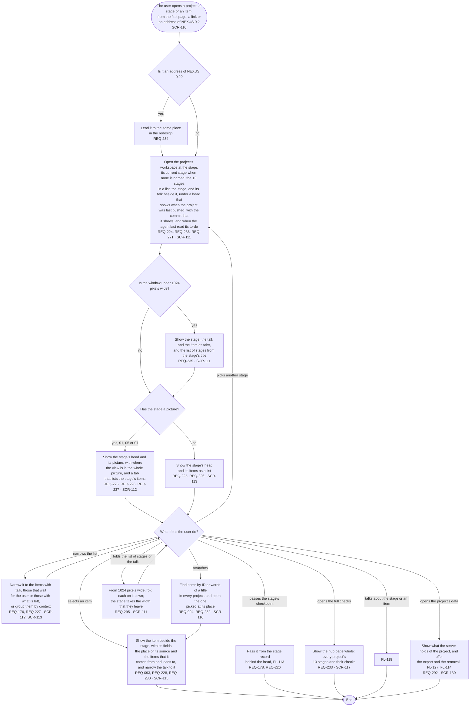

# FL-118 Find the way in a project

[한국어](FL-118-find-the-way-in-a-project.ko.md)

Serves: REQ-093, REQ-094, REQ-176, REQ-178, REQ-224, REQ-225, REQ-226, REQ-227, REQ-228, REQ-230, REQ-232, REQ-233, REQ-234, REQ-235, REQ-236, REQ-237, REQ-271, REQ-292, REQ-295

Context: CTX-008 Overview. Starts when the user opens a project from the first page, a stage or an item from a link, or an address of NEXUS 0.2, on a phone or a PC. New in the redesign of 2026-11-06; until it is built, FL-105 and FL-106 draw the way through the hub page and the picture view. The design revision of 2026-11-11 added the workspace's head with the last push and the agent's last read, the folding of its columns and the project's data.

The search keeps what it does on the hub page today (REQ-094); it only moves into a field at the top of every page, since the first page is no longer the hub page. The redirects of NEXUS 0.2's addresses are listed in [stage 07](../../07-sitemap/nexus.md#addresses). Folding (REQ-295) answers the review of 2026-11-11, finding 11: with the list of stages and the talk open, the stage in the middle was too narrow for its lists and pictures. The project's data is a panel of the workspace (SCR-130, TERM-154), which stage 07 adds.
