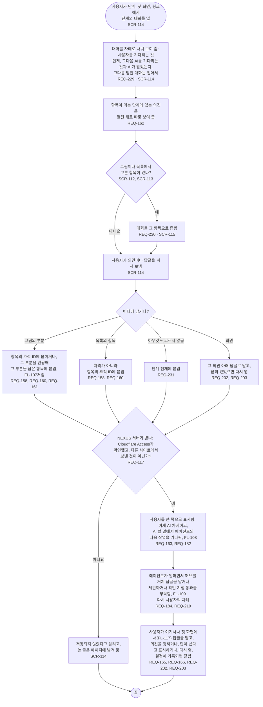

# FL-119 단계나 항목에 대해 대화하기

[English](FL-119-talk-about-a-stage-or-an-item.md)

다루는 요구사항: REQ-117, REQ-158, REQ-160, REQ-161, REQ-162, REQ-163, REQ-165, REQ-166, REQ-182, REQ-184, REQ-202, REQ-203, REQ-219, REQ-229, REQ-230, REQ-231

맥락: CTX-014 논의. 사용자가 휴대폰이나 PC에서 단계, 첫 화면, 링크로 단계의 대화를 열거나, 대화할 항목을 고를 때 시작합니다. 에이전트는 허브를 거쳐 대화합니다(FL-109). 2026-11-06 다시 디자인에서 새로 더합니다: 확인 지점 1의 선택 ② A대로 모든 단계의 항목에 대화를 남깁니다. 그것을 만들기 전까지는 FL-107이 그림의 항목에 남기는 의견만 그립니다.

대화는 의견마다 누구 차례인지 보여 주어, 바로 답하는 채팅처럼 보이지 않게 합니다: 에이전트는 그 프로젝트의 일을 시작할 때에만 읽습니다(01단계의 핫스팟 6). 의견을 저장하지 못했을 때 무엇을 남길지는 FL-107처럼 [README](README.ko.md#기능-명세에서-정할-것)의 14번입니다.
