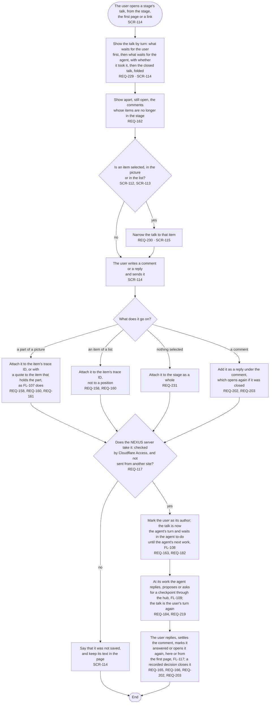

# FL-119 Talk about a stage or an item

[한국어](FL-119-talk-about-a-stage-or-an-item.ko.md)

Serves: REQ-117, REQ-158, REQ-160, REQ-161, REQ-162, REQ-163, REQ-165, REQ-166, REQ-182, REQ-184, REQ-202, REQ-203, REQ-219, REQ-229, REQ-230, REQ-231

Context: CTX-014 Discussion. Starts when the user opens a stage's talk, from the stage, from the first page or from a link, or selects an item to talk about, on a phone or a PC. The agent talks through the hub (FL-109). New in the redesign of 2026-11-06: talk on the items of every stage, choice ② A of its checkpoint 1; until it is built, FL-107 draws comments on the pictures' items only.

The talk shows whose turn it is on every comment, so that it does not look like a chat that answers at once: the agent reads it only when its work on the project starts (hotspot 6 of stage 01). What is kept when a comment cannot be saved is point 14 of the [README](README.md#points-for-the-functional-spec), as for FL-107.
