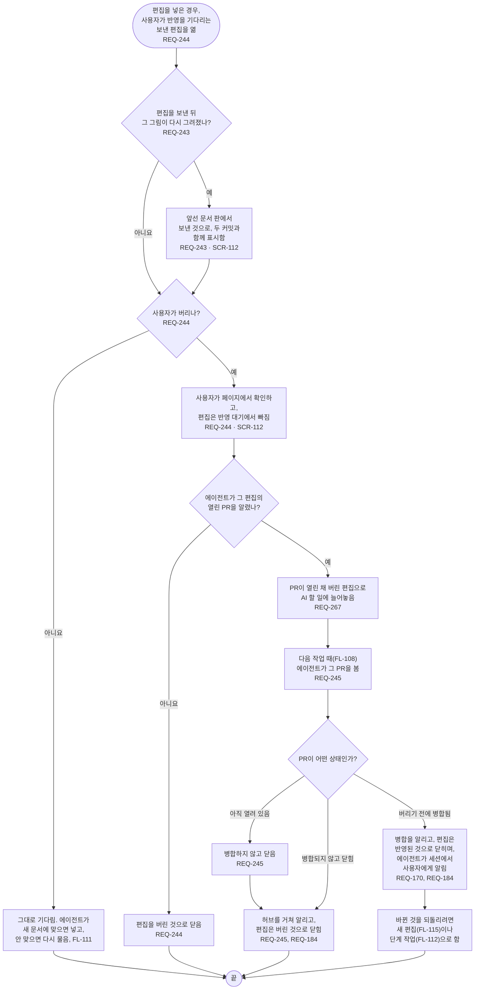

# FL-125 반영을 기다리는 편집 버리기

[English](FL-125-drop-a-sent-edit.md)

다루는 요구사항: REQ-170, REQ-184, REQ-243, REQ-244, REQ-245, REQ-267

맥락: CTX-010 편집, 그리고 AI 할 일은 CTX-007 단계 진행. 편집을 넣은 경우, 곧 ② 차례이며 NEXUS 0.2에는 없습니다. 사용자가 그림 보기나 단계의 대화에서, 보냈고 반영을 기다리는 편집을 열 때 시작합니다. 2026-11-07에 ② 차례의 01단계 프레임에서 그렸습니다.

임시 저장은 FL-115에서 편집 충돌일 때나 보내기 전에 버립니다. 이 흐름은 보낸 편집을 버립니다. NEXUS는 PR을 닫지 않습니다: PR을 여는 것처럼(FL-111) 에이전트가 다음 작업 때 닫습니다.
