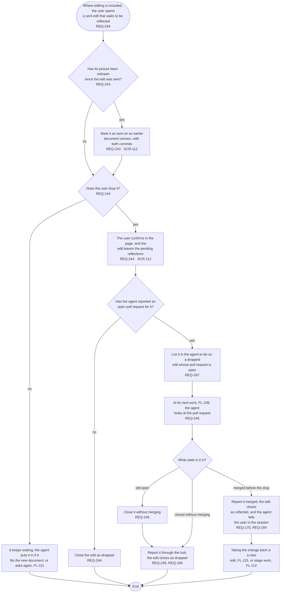

# FL-125 Drop an edit that waits to be reflected

[한국어](FL-125-drop-a-sent-edit.ko.md)

Serves: REQ-170, REQ-184, REQ-243, REQ-244, REQ-245, REQ-267

Context: CTX-010 Editing, with CTX-007 Stage progress for the agent to-do. Where editing is included, in phase ②; not in NEXUS 0.2. Starts when the user opens an edit that was sent and waits to be reflected, in the picture view or in the stage's talk. Drawn on 2026-11-07 from stage 01's frames for phase ②.

An edit draft is dropped in FL-115, as an edit conflict or before it is sent; this flow drops an edit that was sent. NEXUS never closes a pull request: the agent does at its next work, as it opens them (FL-111).
