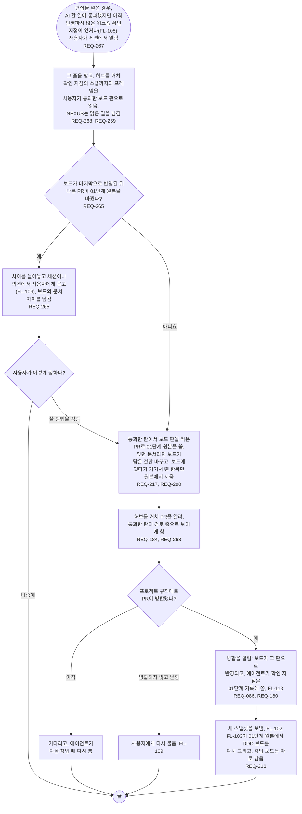

# FL-126 워크숍의 보드 반영하기

[English](FL-126-reflect-a-workshop.md)

다루는 요구사항: REQ-086, REQ-180, REQ-184, REQ-216, REQ-217, REQ-259, REQ-265, REQ-267, REQ-268, REQ-290

맥락: CTX-016 워크숍, 그리고 AI 할 일과 단계 기록은 CTX-007 단계 진행. 편집을 넣은 경우, 곧 ② 차례이며 NEXUS 0.2에는 없습니다. AI 할 일에 통과했지만 아직 반영하지 않은 워크숍 확인 지점이 있거나(FL-108), 사용자가 세션에서 에이전트에게 확인 지점을 통과했다고 알릴 때 시작합니다. 2026-11-07에 ② 차례의 01단계 프레임에서 그렸습니다. 2026-11-11의 설계 수정이 에이전트가 있던 원본에서 지워도 되는 것을 더했습니다(REQ-290).

에이전트는 사용자가 통과시킨 것만 씁니다: 확인 지점의 스텝까지의 프레임을, 통과와 함께 남은 보드 판으로. 뒤에 다음 프레임에서 바뀐 것은 다음 확인 지점을 기다립니다. 워크숍이 도는 동안은 보드가 앞서지만, 다른 PR이 01단계 원본에 낸 바뀜을 모르는 새 덮어쓰지 않습니다: 에이전트는 01단계의 맞추기 규칙대로 차이를 보여 주고 사용자가 정한 대로 씁니다. 보드에 올린 적 없는 원본의 항목은 원본에 남습니다: 에이전트는 원본에서 온 것으로 표시되어 보드에 있다가 거기서 뗀 것만 지웁니다(REQ-289, REQ-290).
