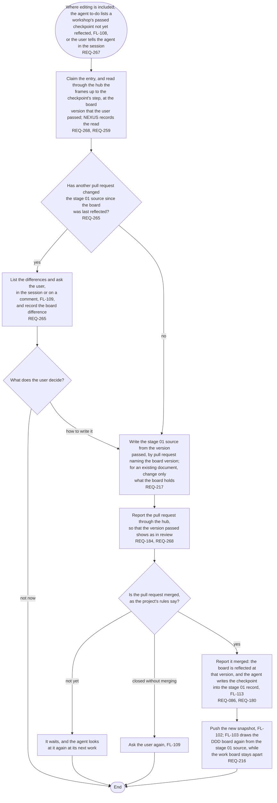

# FL-126 Reflect a workshop's board

[한국어](FL-126-reflect-a-workshop.ko.md)

Serves: REQ-086, REQ-180, REQ-184, REQ-216, REQ-217, REQ-259, REQ-265, REQ-267, REQ-268

Context: CTX-016 Workshops, with CTX-007 Stage progress for the agent to-do and the stage record. Where editing is included, in phase ②; not in NEXUS 0.2. Starts when the agent to-do lists a workshop's passed checkpoint that is not yet reflected (FL-108), or when the user tells the agent in the session that a checkpoint passed. Drawn on 2026-11-07 from stage 01's frames for phase ②.

The agent writes only what the user passed: the frames up to the checkpoint's step, at the board version recorded with the pass. A change made later, on the next frame, waits for the next checkpoint. The board leads while the workshop runs, yet a change that another pull request made to the stage 01 source is never overwritten unseen: the agent shows the differences, as stage 01's sync rule asks, and writes as the user decides.
