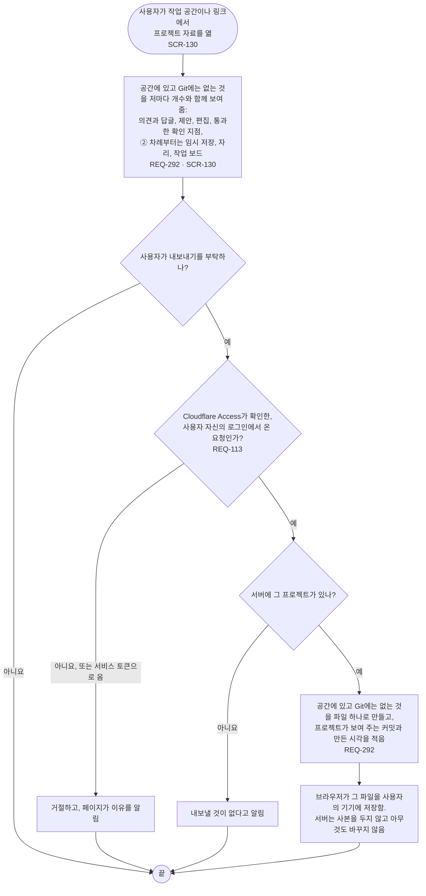

# FL-127 프로젝트 공간 내보내기

[English](FL-127-export-a-project-space.md)

다루는 요구사항: REQ-113, REQ-292

맥락: CTX-009 함께 보기. 사용자가 휴대폰이나 PC의 NEXUS에서 프로젝트 자료를 열고 내보내기를 부탁할 때 시작합니다. 2026-11-11의 설계 수정에서 새로 더합니다(그날 검토의 발견 15): 프로젝트 공간에는 Git에 없는 의견, 제안, 통과한 확인 지점이 있는데, 사용자가 그 사본을 받을 길이 없었습니다.

내보내기는 스냅샷이 아닙니다: 스냅샷은 허브가 단계별 원본에서 읽은 것이고, 그것은 Git에 있습니다(TERM-065, TERM-152). 내보내기는 지우기 전에 사용자가 받아 두는 사본이며(FL-114), 다른 기계에 사본을 두는 서버의 백업(REQ-291, 서버 전체에 걸리는 요구사항이라 흐름으로 그리지 않음)과는 따로입니다. 파일에 정확히 무엇이 담기는지, 그 형식과 한도는 [README](README.ko.md#기능-명세에서-정할-것)의 30번입니다.
