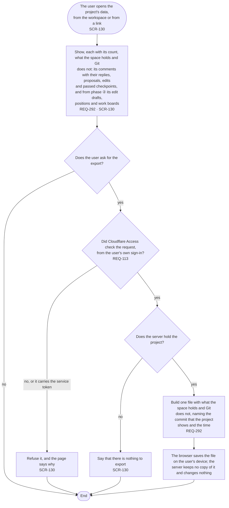

# FL-127 Export a project space

[한국어](FL-127-export-a-project-space.ko.md)

Serves: REQ-113, REQ-292

Context: CTX-009 Sharing. Starts when the user opens a project's data in NEXUS and asks for an export, on a phone or a PC. New with the design revision of 2026-11-11 (the review of that day, finding 15): a project space holds comments, proposals and passed checkpoints that Git does not, and nothing let the user take a copy of them.

The export is not a snapshot: a snapshot is what the hub reads from the stage sources, and Git holds those (TERM-065, TERM-152). It is the user's own copy before a removal (FL-114), apart from the server's backup, which keeps a copy on another machine (REQ-291, which holds for the whole server, so no flow draws it). What the file holds exactly, its format and its limits are point 30 of the [README](README.md#points-for-the-functional-spec).
