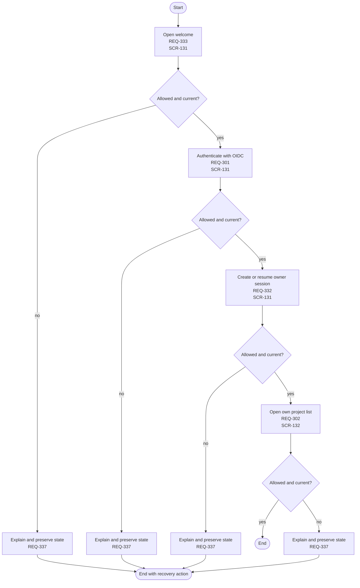

# FL-128 가입과 비공개 프로젝트 복귀

[English](FL-128.md)

연결: REQ-301, REQ-302, REQ-332, REQ-333, REQ-337, REQ-350

화면: SCR-131, SCR-132

상태: 사용자님의 설계 진행 지시에 따라 작성했습니다. 실제 NEXUS 통과와 별개이며 제품 실행 증거가 아닙니다.

| 실패 조건 | 사용자가 확인하는 결과 |
| --- | --- |
| 공급자 거부·시간 초과 | 세션을 만들지 않고 시작 화면에서 재시도합니다. |
| 다른 소유자 프로젝트 주소 | 존재 여부를 구분하지 않는 접근 불가 상태와 내 목록으로 돌아가기를 제공합니다. |
| 세션 만료 | 같은 출처의 안전한 복귀 경로를 보관하고 로그인 뒤 다시 읽습니다. |

모든 경로는 성공 또는 복구 동작을 제공하는 종료에 도달합니다. 재시도는 동일한 요청 키를 재사용합니다. 체크포인트 결정은 실제 사용자 세션만 수행합니다. 07에서 화면 ID를 연결하고 08에서 각 결과를 상태로 정의합니다.
