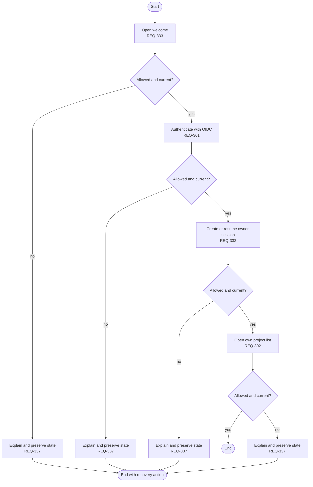

# FL-128 Join and return to a private project

[한국어](FL-128.ko.md)

Serves: REQ-301, REQ-302, REQ-332, REQ-333, REQ-337, REQ-350

Status: authored under the design-continuation instruction; distinct from an actual NEXUS pass or product execution evidence.

| Failure or alternative | User-visible result |
| --- | --- |
| Provider refused or timed out | Return to welcome with a retry; no owner session created. |
| Another owner project address | Show an indistinguishable unavailable response; return to own list. |
| Expired session | Keep only a safe same-origin return path, sign in again and reload. |

Every path ends with success or an explicit recovery action. A retried write reuses its request key. Only the real human session decides a checkpoint. Stage 07 attaches screen IDs; stage 08 defines each visible outcome.
