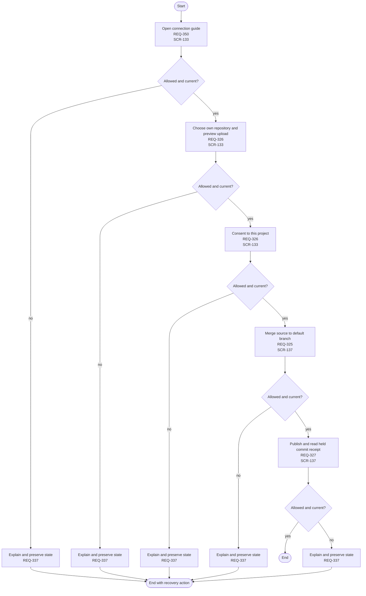

# FL-129 연결·최초 동의·게시

[English](FL-129.md)

연결: REQ-325, REQ-326, REQ-327, REQ-328, REQ-329, REQ-330, REQ-331, REQ-348, REQ-350

화면: SCR-133, SCR-137

상태: 사용자님의 설계 진행 지시에 따라 작성했습니다. 실제 NEXUS 통과와 별개이며 제품 실행 증거가 아닙니다.

| 실패 조건 | 사용자가 확인하는 결과 |
| --- | --- |
| 동의 없음 | 업로드하지 않고 미리보기와 동의 동작을 제공합니다. |
| 미병합·오래된 커밋 | 교체를 거부하고 보유·요청 커밋과 fetch 안내를 표시합니다. |
| gh·인증·시크릿 누락·전송 실패 | 전송되지 않은 재시도 결과와 수동 push 안내를 남기며 성공을 주장하지 않습니다. |

모든 경로는 성공 또는 복구 동작을 제공하는 종료에 도달합니다. 재시도는 동일한 요청 키를 재사용합니다. 체크포인트 결정은 실제 사용자 세션만 수행합니다. 07에서 화면 ID를 연결하고 08에서 각 결과를 상태로 정의합니다.
