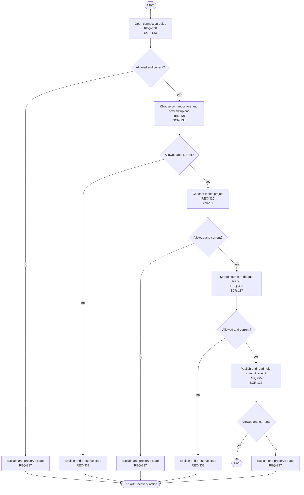

# FL-129 Connect, consent and publish

[한국어](FL-129.ko.md)

Serves: REQ-325, REQ-326, REQ-327, REQ-328, REQ-329, REQ-330, REQ-331, REQ-348, REQ-350

Screens: SCR-133, SCR-137

Status: authored under the design-continuation instruction; distinct from an actual NEXUS pass or product execution evidence.

| Failure or alternative | User-visible result |
| --- | --- |
| Consent absent | Do not upload; show preview and the consent action. |
| Unmerged or older commit | Refuse replacement; show held/attempted commits and fetch guidance. |
| Missing gh/auth/secrets or upload failure | Keep a retryable not-sent result and manual push guidance; never claim successful delivery. |

Every path ends with success or an explicit recovery action. A retried write reuses its request key. Only the real human session decides a checkpoint. Stage 07 attaches screen IDs; stage 08 defines each visible outcome.
