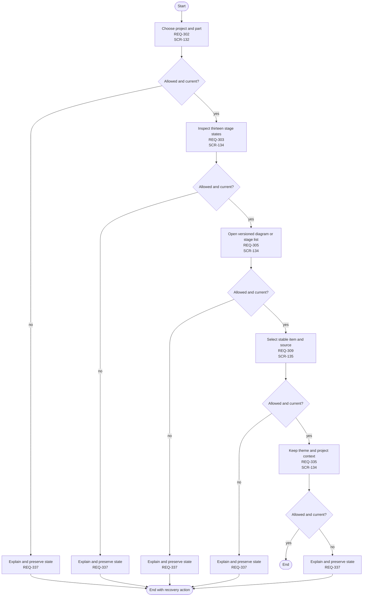

# FL-130 전체 단계와 항목 검토

[English](FL-130.md)

연결: REQ-302, REQ-303, REQ-304, REQ-305, REQ-306, REQ-307, REQ-308, REQ-309, REQ-310, REQ-334, REQ-335, REQ-336, REQ-337, REQ-338, REQ-339, REQ-349

화면: SCR-132, SCR-134, SCR-135

상태: 사용자님의 설계 진행 지시에 따라 작성했습니다. 실제 NEXUS 통과와 별개이며 제품 실행 증거가 아닙니다.

| 실패 조건 | 사용자가 확인하는 결과 |
| --- | --- |
| 산출물 없음·미지원 소스 | 없음·미지원 상태를 구분하고 게시 안내와 안전한 소스 진단을 표시합니다. |
| 로딩·오프라인·접근 거부 | 레이아웃을 유지하고 재시도·로그인을 제공하며 비공개 데이터를 노출하지 않습니다. |
| 제거된 항목·이전 주소 | 버전과 원래 대화를 유지하고 제거 사실과 최신 소스를 안내합니다. |

모든 경로는 성공 또는 복구 동작을 제공하는 종료에 도달합니다. 재시도는 동일한 요청 키를 재사용합니다. 체크포인트 결정은 실제 사용자 세션만 수행합니다. 07에서 화면 ID를 연결하고 08에서 각 결과를 상태로 정의합니다.
