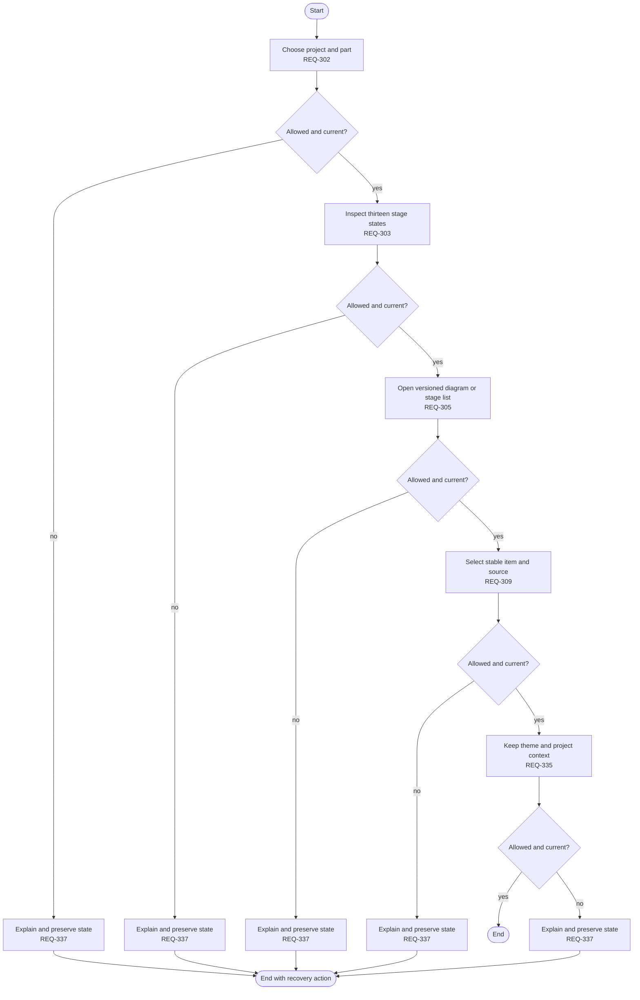

# FL-130 Review every stage and item

[한국어](FL-130.ko.md)

Serves: REQ-302, REQ-303, REQ-304, REQ-305, REQ-306, REQ-307, REQ-308, REQ-309, REQ-310, REQ-334, REQ-335, REQ-336, REQ-337, REQ-338, REQ-339, REQ-349

Status: authored under the design-continuation instruction; distinct from an actual NEXUS pass or product execution evidence.

| Failure or alternative | User-visible result |
| --- | --- |
| No artifact or unsupported source | Show missing/unsupported separately with publish guidance and source diagnostics. |
| Loading, offline or refused | Keep layout; provide retry or sign-in without leaking private data. |
| Removed item or old address | Keep version selection and original discussion; explain removal and offer latest source. |

Every path ends with success or an explicit recovery action. A retried write reuses its request key. Only the real human session decides a checkpoint. Stage 07 attaches screen IDs; stage 08 defines each visible outcome.
