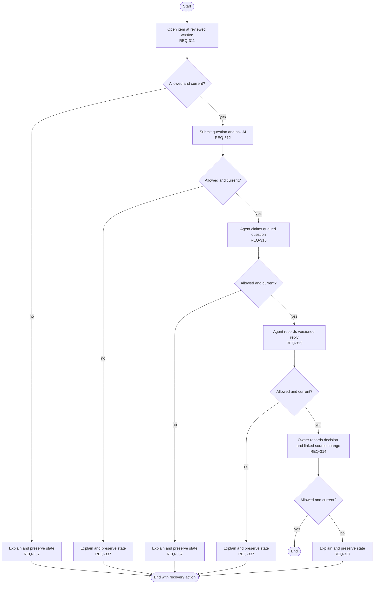

# FL-131 외부 AI 에이전트와 항목 대화

[English](FL-131.md)

연결: REQ-311, REQ-312, REQ-313, REQ-314, REQ-315, REQ-316, REQ-330, REQ-337, REQ-340

상태: 사용자님의 설계 진행 지시에 따라 작성했습니다. 실제 NEXUS 통과와 별개이며 제품 실행 증거가 아닙니다.

| 실패 조건 | 사용자가 확인하는 결과 |
| --- | --- |
| 빈·초과 입력·요청 제한 | 초안을 유지하고 필드 오류·재시도 시간을 안내하며 일부만 저장하지 않습니다. |
| 에이전트 없음·claim 만료 | 대기 상태를 표시하고 만료 후 다른 claim을 허용하되 답변을 중복 기록하지 않습니다. |
| 답변 중 소스 변경 | 답변을 원래 버전에 남기고 새 버전 안내를 표시합니다. |
| 병합 소스 없는 제안 | 제안 상태를 유지하며 검증한 main 게시만 반영 완료로 표시합니다. |

모든 경로는 성공 또는 복구 동작을 제공하는 종료에 도달합니다. 재시도는 동일한 요청 키를 재사용합니다. 체크포인트 결정은 실제 사용자 세션만 수행합니다. 07에서 화면 ID를 연결하고 08에서 각 결과를 상태로 정의합니다.
