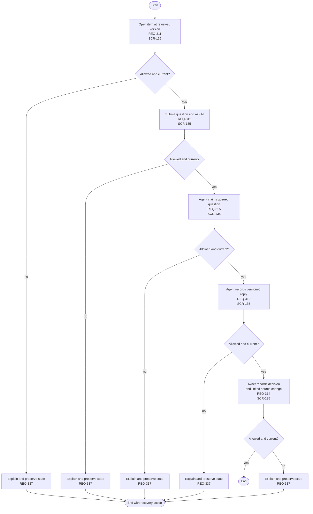

# FL-131 Discuss with an external AI agent

[한국어](FL-131.ko.md)

Serves: REQ-311, REQ-312, REQ-313, REQ-314, REQ-315, REQ-316, REQ-330, REQ-337, REQ-340

Screens: SCR-135

Status: authored under the design-continuation instruction; distinct from an actual NEXUS pass or product execution evidence.

| Failure or alternative | User-visible result |
| --- | --- |
| Empty/oversized text or rate limit | Keep local draft, identify the field or retry time; no partial write. |
| No agent or expired claim | Show queued/waiting; permit another claim after lease expiry without duplicate replies. |
| Source changed while answering | Keep the reply on its original version and show the new-version notice. |
| Proposal without merged source | Show proposed; only verified main publication can mark reflected. |

Every path ends with success or an explicit recovery action. A retried write reuses its request key. Only the real human session decides a checkpoint. Stage 07 attaches screen IDs; stage 08 defines each visible outcome.
