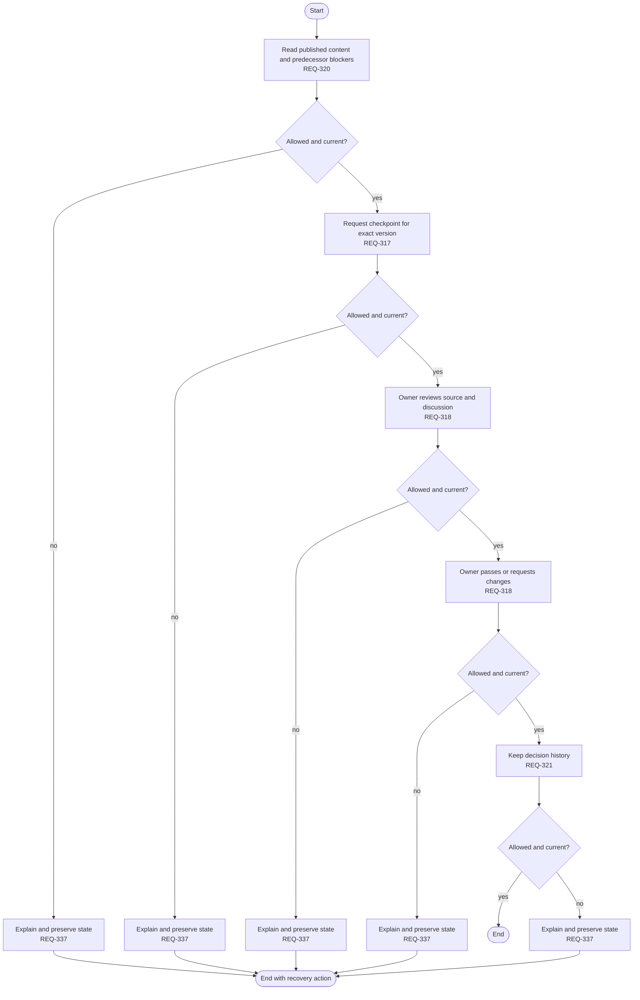

# FL-132 체크포인트 요청과 사용자 결정

[English](FL-132.md)

연결: REQ-317, REQ-318, REQ-319, REQ-320, REQ-321, REQ-322, REQ-323, REQ-324, REQ-337

상태: 사용자님의 설계 진행 지시에 따라 작성했습니다. 실제 NEXUS 통과와 별개이며 제품 실행 증거가 아닙니다.

| 실패 조건 | 사용자가 확인하는 결과 |
| --- | --- |
| 기계 자격 증명으로 결정 시도 | 결정을 기록하지 않고 403을 반환하며 사용자 로그인을 안내합니다. |
| 요청 후 새 콘텐츠·동시 결정 | 오래된 버전을 표시하고 정확한 콘텐츠를 다시 읽어 재검토합니다. |
| 필수 선행 체크포인트 대기 | 준비는 허용하고 종속 완료는 막으며 선행 단계를 표시합니다. |
| 철회 | 원래 승인과 연결한 철회를 추가하고 이력을 삭제하지 않습니다. |

모든 경로는 성공 또는 복구 동작을 제공하는 종료에 도달합니다. 재시도는 동일한 요청 키를 재사용합니다. 체크포인트 결정은 실제 사용자 세션만 수행합니다. 07에서 화면 ID를 연결하고 08에서 각 결과를 상태로 정의합니다.
