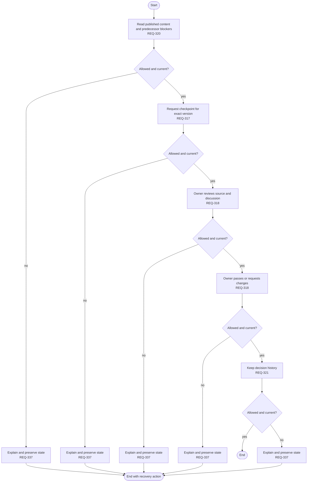

# FL-132 Request and decide a checkpoint

[한국어](FL-132.ko.md)

Serves: REQ-317, REQ-318, REQ-319, REQ-320, REQ-321, REQ-322, REQ-323, REQ-324, REQ-337

Status: authored under the design-continuation instruction; distinct from an actual NEXUS pass or product execution evidence.

| Failure or alternative | User-visible result |
| --- | --- |
| Machine credential attempts decision | Refuse 403 with no decision; human sign-in remains required. |
| New content after request or competing decision | Show stale version; reload exact content and request/review again. |
| Required predecessor pending | Allow preparation but block dependent completion; show the named predecessor. |
| Withdrawal | Append withdrawal with original approval link; do not delete history. |

Every path ends with success or an explicit recovery action. A retried write reuses its request key. Only the real human session decides a checkpoint. Stage 07 attaches screen IDs; stage 08 defines each visible outcome.
