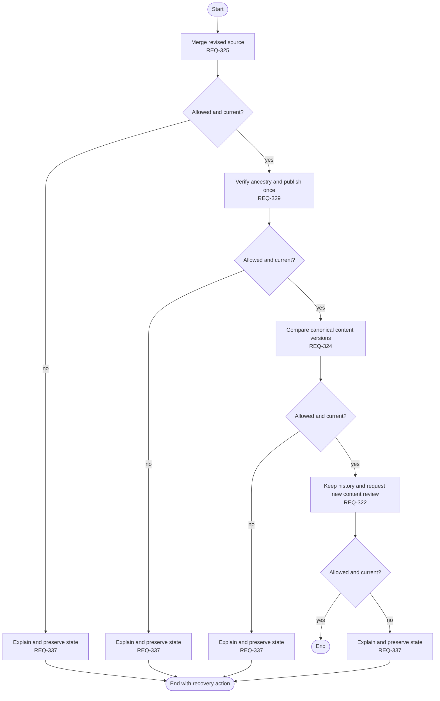

# FL-133 승인 후 변경 게시

[English](FL-133.md)

연결: REQ-308, REQ-321, REQ-322, REQ-324, REQ-325, REQ-327, REQ-328, REQ-329, REQ-337

상태: 사용자님의 설계 진행 지시에 따라 작성했습니다. 실제 NEXUS 통과와 별개이며 제품 실행 증거가 아닙니다.

| 실패 조건 | 사용자가 확인하는 결과 |
| --- | --- |
| 표시 메타데이터만 변경 | 콘텐츠 버전·승인을 유지하고 게시 출처를 갱신합니다. |
| 검토 콘텐츠·분류 불명 변경 | 새 콘텐츠 버전을 만들고 과거 결정을 보존하며 새 체크포인트를 요청합니다. |
| 응답 유실·중복 게시 | 같은 키로 재시도해 보유 버전·결과를 하나만 남깁니다. |

모든 경로는 성공 또는 복구 동작을 제공하는 종료에 도달합니다. 재시도는 동일한 요청 키를 재사용합니다. 체크포인트 결정은 실제 사용자 세션만 수행합니다. 07에서 화면 ID를 연결하고 08에서 각 결과를 상태로 정의합니다.
