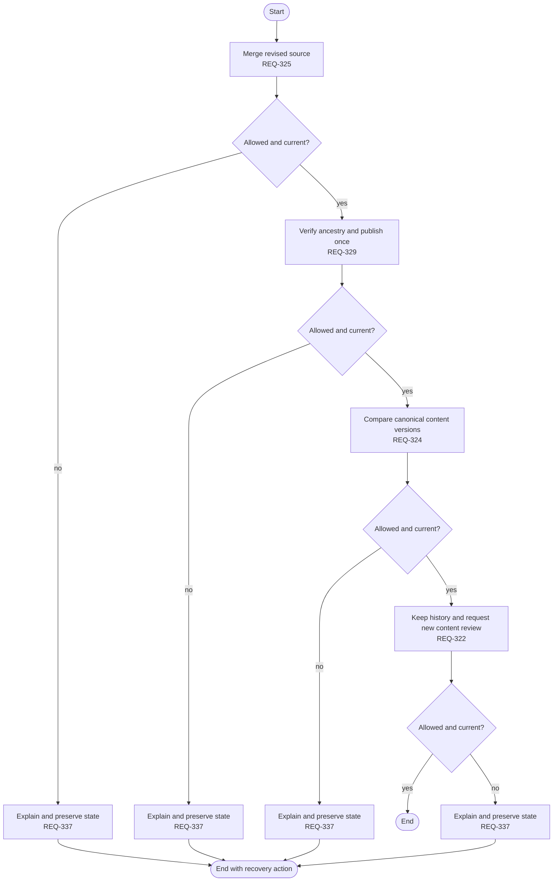

# FL-133 Publish changes after approval

[한국어](FL-133.ko.md)

Serves: REQ-308, REQ-321, REQ-322, REQ-324, REQ-325, REQ-327, REQ-328, REQ-329, REQ-337

Status: authored under the design-continuation instruction; distinct from an actual NEXUS pass or product execution evidence.

| Failure or alternative | User-visible result |
| --- | --- |
| Only enumerated display metadata changed | Keep content version and approval; update publication provenance. |
| Reviewable content or unknown change | Create new content version, preserve old decision and require a fresh checkpoint. |
| Response lost or duplicate publication | Retry the same idempotency key; one held revision and receipt. |

Every path ends with success or an explicit recovery action. A retried write reuses its request key. Only the real human session decides a checkpoint. Stage 07 attaches screen IDs; stage 08 defines each visible outcome.
