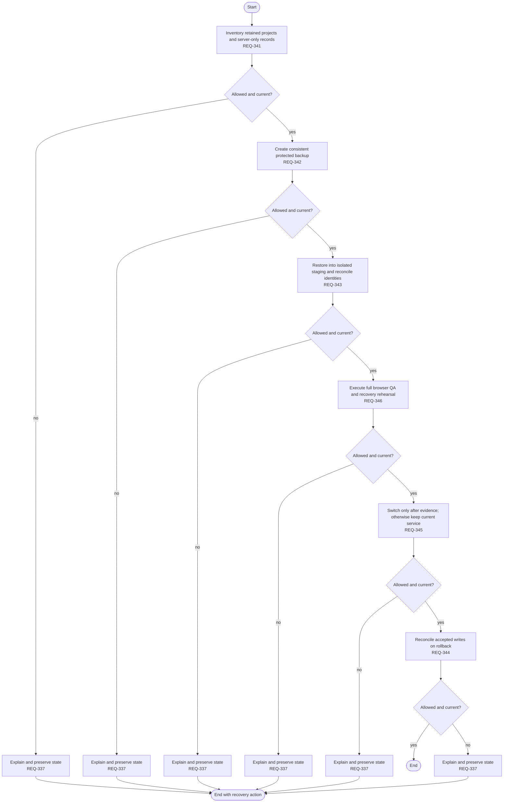

# FL-134 이전·검증·복구

[English](FL-134.md)

연결: REQ-341, REQ-342, REQ-343, REQ-344, REQ-345, REQ-346, REQ-347, REQ-330

상태: 사용자님의 설계 진행 지시에 따라 작성했습니다. 실제 NEXUS 통과와 별개이며 제품 실행 증거가 아닙니다.

| 실패 조건 | 사용자가 확인하는 결과 |
| --- | --- |
| 백업 누락·개수 불일치·참조 오류 | 운영 교체를 중단하고 보호된 증거로 원인을 확인합니다. |
| 교체 후 검증 실패 | 쓰기를 잠시 중지하고 쓰기 기록을 내보낸 뒤 호환 버전을 복원해 확인 응답한 모든 쓰기를 재적용·대조합니다. |
| 새 쓰기 보존 실패 | 새 데이터베이스를 보호하고 복구 완료로 기록하지 않으며 운영자가 해결합니다. |

모든 경로는 성공 또는 복구 동작을 제공하는 종료에 도달합니다. 재시도는 동일한 요청 키를 재사용합니다. 체크포인트 결정은 실제 사용자 세션만 수행합니다. 07에서 화면 ID를 연결하고 08에서 각 결과를 상태로 정의합니다.
