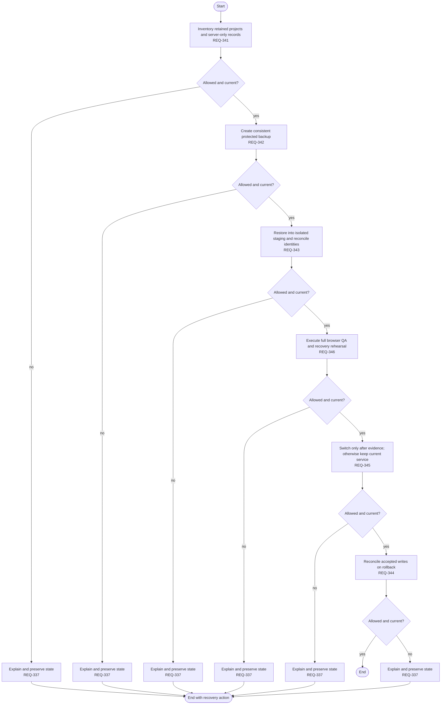

# FL-134 Migrate, validate and recover

[한국어](FL-134.ko.md)

Serves: REQ-341, REQ-342, REQ-343, REQ-344, REQ-345, REQ-346, REQ-347, REQ-330

Screens: none. Operator-only CLI, not a public browser screen. API-237, API-238, API-239, API-240.

Status: authored under the design-continuation instruction; distinct from an actual NEXUS pass or product execution evidence.

| Failure or alternative | User-visible result |
| --- | --- |
| Missing backup, mismatched counts or orphan references | Stop the switch and keep current production; diagnose using protected evidence. |
| Validation fails after switch | Freeze writes briefly, export the write journal, restore compatible runtime and replay/reconcile every acknowledged write. |
| Restore cannot preserve a new write | Keep the new database protected, do not declare recovery complete; require an operator resolution. |

Every path ends with success or an explicit recovery action. A retried write reuses its request key. Only the real human session decides a checkpoint. Stage 07 attaches screen IDs; stage 08 defines each visible outcome.
