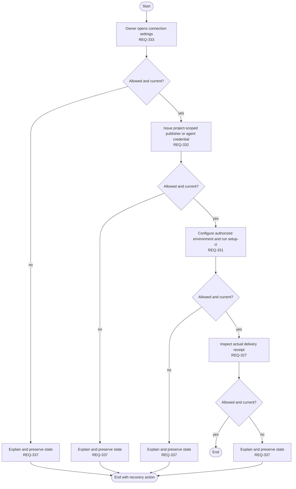

# FL-135 게시 권한 설정과 철회

[English](FL-135.md)

연결: REQ-326, REQ-330, REQ-331, REQ-332, REQ-333, REQ-350, REQ-327, REQ-328

상태: 사용자님의 설계 진행 지시에 따라 작성했습니다. 실제 NEXUS 통과와 별개이며 제품 실행 증거가 아닙니다.

| 실패 조건 | 사용자가 확인하는 결과 |
| --- | --- |
| gh 없음·미로그인 | 안전한 한 줄로 건너뛰기를 알리고 수동 경로를 유지합니다. |
| GitHub Secrets 권한 거부 | 값 없이 필요한 권한을 알리고 설정 완료로 기록하지 않습니다. |
| 자격 증명 철회 | 이후 사용을 거부하고 이전 게시 결과·감사 이력을 보존합니다. |

모든 경로는 성공 또는 복구 동작을 제공하는 종료에 도달합니다. 재시도는 동일한 요청 키를 재사용합니다. 체크포인트 결정은 실제 사용자 세션만 수행합니다. 07에서 화면 ID를 연결하고 08에서 각 결과를 상태로 정의합니다.
